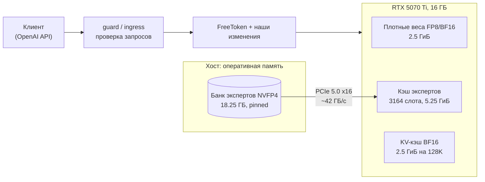
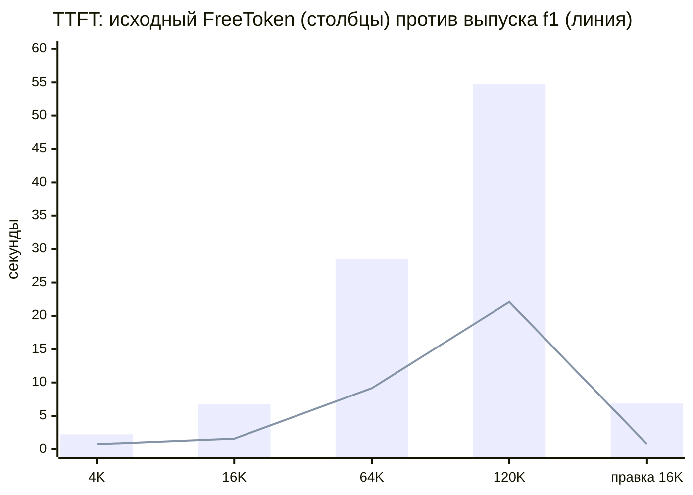
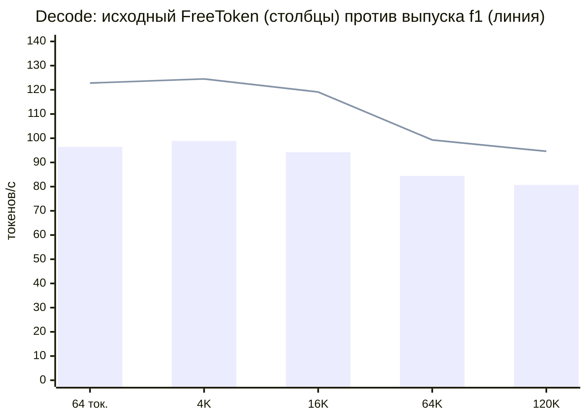
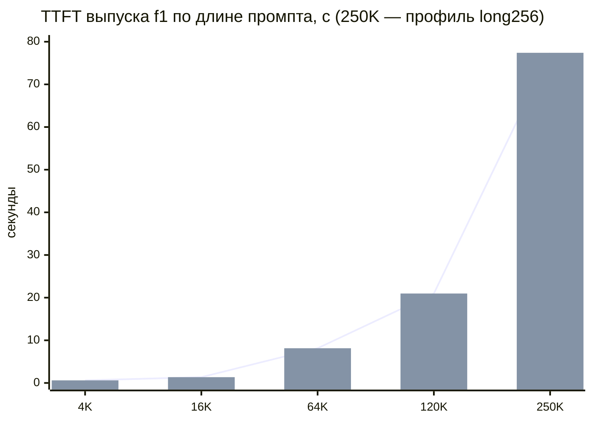
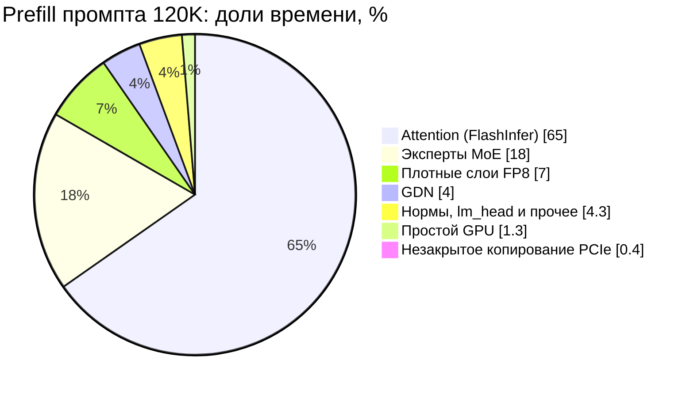
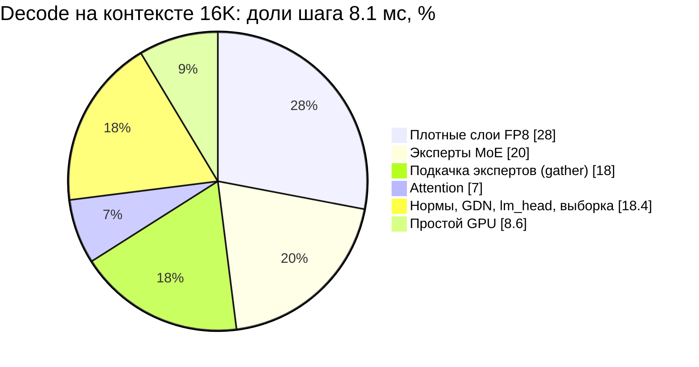
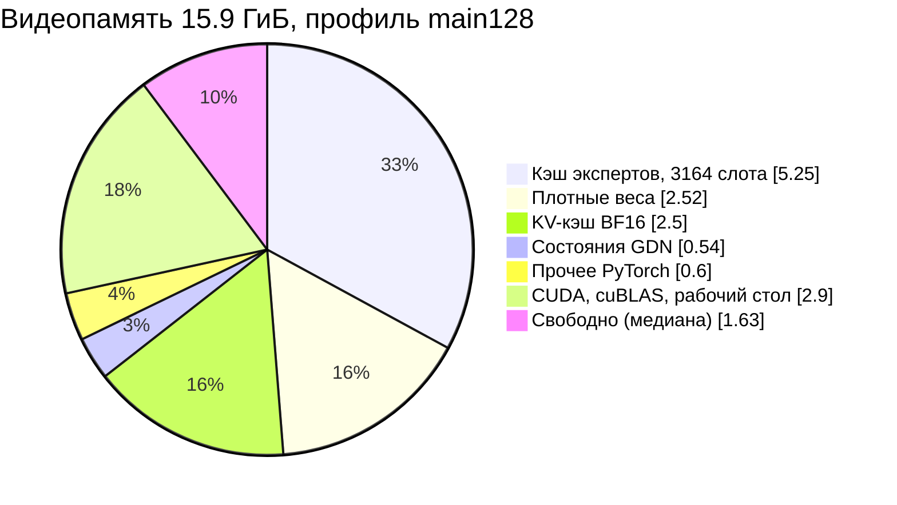

# qwen36-moe-16gb

**Qwen3.6-35B-A3B (NVFP4, 256 экспертов, top-8) на одной видеокарте с 16 ГБ: в 2.5–9 раз быстрее по времени до первого токена, на 20–30% быстрее в генерации, с побитово тем же результатом.**

[English version](README.en.md) · [Архитектура](docs/ARCHITECTURE.md) · [Все результаты](docs/RESULTS.md) · [Методика](docs/METHODOLOGY.md) · [План](docs/ROADMAP.md)

| | |
|---|---|
| Модель | `nvidia/Qwen3.6-35B-A3B-NVFP4` (35B параметров, 3B активных на токен) |
| Железо | RTX 5070 Ti 16 ГБ (SM120, Blackwell), PCIe 5.0 x16, 64 ГБ RAM |
| Движок | доработанный [FreeToken](https://github.com/FlashML-org/FreeToken) 0.1.3 + собственные CUDA-ядра |
| Контекст | до 131 072 токенов (основной профиль) и до 262 144 (профиль `long256`) |
| Качество | teacher-forcing: **125/125 логитов побитово совпадают** с эталоном, перплексия +0.0% |
| Статус | выпуск **f1**, 14.10.2026, все гейты пройдены, работает в домашнем API |

---

## Оглавление

- [Зачем это и как устроено](#зачем-это-и-как-устроено)
- [Главные результаты](#главные-результаты)
- [Что именно мы сделали](#что-именно-мы-сделали)
- [Куда уходит время: профиль Nsight](#куда-уходит-время-профиль-nsight)
- [Память и KV-кэш](#память-и-kv-кэш)
- [Гарантия качества](#гарантия-качества)
- [Стабильность и эксплуатация](#стабильность-и-эксплуатация)
- [Найденные ошибки и подводные камни](#найденные-ошибки-и-подводные-камни)
- [Профили](#профили)
- [Железо и софт](#железо-и-софт)
- [Структура репозитория](#структура-репозитория)
- [Быстрый старт](#быстрый-старт)
- [Ограничения](#ограничения)
- [Что дальше](#что-дальше)
- [FAQ](#faq)
- [Благодарности и лицензия](#благодарности-и-лицензия)

---

## Зачем это и как устроено

Qwen3.6-35B-A3B — MoE-модель. На каждый токен работают только 8 из 256 экспертов в каждом из 40 слоёв, поэтому вычислений немного. Но вся модель в NVFP4 весит ~21 ГБ, а у видеокарты 16 ГБ, и часть из них занимает рабочий стол.

Решение — **выгрузка экспертов**: весь банк экспертов (18.25 ГБ) лежит в закреплённой (pinned) памяти хоста, а на GPU хранятся плотные веса, KV-кэш и **кэш слотов экспертов**. Недостающих экспертов GPU подкачивает по PCIe по мере надобности.



В исходном FreeToken такая схема работает, но медленно:
- prefill гоняет банк экспертов по PCIe **на каждый чанк** промпта: на промпт 120K это ~1 ТБ трафика;
- MoE считается Triton-ядром, которое на этой архитектуре упирается в L1/TEX;
- в decode каждый промах кэша экспертов копируется медленным ядром.

Мы переписали эти узкие места так, чтобы **результат не изменился ни в одном бите**.

---

## Главные результаты

### 1. Парная матрица: выпуск f1 против исходного FreeToken на 128K

База `bf128` — механика исходного FreeToken: Triton NVFP4 MoE, чанк 2048, KV в BF16, контекст 131072, плюс исправление FP32-масштабов (см. [«Гарантия качества»](#гарантия-качества)). Протокол: 5 парных раундов в чередующемся порядке, ровно 128 токенов ответа, одна сессия. В таблице медианы.

| Случай | TTFT bf128 | TTFT f1 | Ускорение TTFT | Decode bf128 | Decode f1 | Весь запрос |
|---|---:|---:|---:|---:|---:|---:|
| Промпт 64 токена | 0.75 с | 0.79 с | ×0.94 (вне гейта) | 96.4 ток/с | 122.8 ток/с | ×1.13 |
| 4K | 2.24 с | 0.77 с | **×2.9** | 98.9 ток/с | 124.5 ток/с | ×1.95 |
| 16K | 6.78 с | 1.59 с | **×4.3** | 94.2 ток/с | 119.1 ток/с | ×3.03 |
| 64K | 28.46 с | 9.14 с | **×3.1** | 84.4 ток/с | 99.3 ток/с | ×2.86 |
| 120K | 54.77 с | 22.07 с | **×2.5** | 80.7 ток/с | 94.6 ток/с | ×2.45 |
| Продолжение диалога, 4K | 2.20 с | 0.78 с | ×2.9 | 106.4 ток/с | 126.9 ток/с | ×1.91 |
| Правка последнего сообщения, 16K | 6.85 с | 0.78 с | **×8.8** | 90.4 ток/с | 112.4 ток/с | ×4.44 |
| Правка результата инструмента, 16K | 7.11 с | 0.76 с | **×9.4** | 94.9 ток/с | 113.4 ток/с | ×4.49 |
| Цикл вызова инструмента (вся задача) | | | | | | ×1.08 (ДИ 0.97–1.20) |

**Вердикт: PASS.** f1 не хуже базы во всех 9 гейтовых случаях, а выигрыш ≥ 5% держится с поправкой Бонферрони.

**Время до первого токена, секунды** (столбцы — исходный FreeToken, линия — выпуск f1; меньше — лучше):



**Скорость генерации, токенов в секунду** (больше — лучше):



### 2. Одинаковые условия на 64K

Чтобы сравнить с самыми первыми замерами исходного FreeToken, все три варианта прогнаны в одной сессии: контекст 65536, ответ 192 токена, прогрев 60 с, 2 раунда в обратном порядке. В ячейках TTFT / decode.

| Промпт | Исходный FreeToken (FP16-масштабы) | + исправление FP32 | Выпуск f1 | f1 против исходного |
|---|---:|---:|---:|---|
| 4K | 1.93 с / 116.0 ток/с | 1.85 с / 118.1 | **0.58 с / 142.4** | TTFT ×3.3, decode +23% |
| 16K | 6.04 с / 111.3 | 5.86 с / 115.7 | **1.49 с / 138.0** | TTFT ×4.1, decode +24% |
| 60K | 22.86 с / 101.3 | 22.43 с / 107.6 | **7.50 с / 122.2** | TTFT ×3.0, decode +21% |

Раунды выпуска расходятся меньше чем на 0.3%. Исправление FP32-масштабов decode не замедлило.

### 3. Длинный контекст (профиль `long256`, 262 144 токена)

| Замер | Механика исходного FreeToken | Выпуск f1 |
|---|---:|---:|
| Свежий промпт 250K, TTFT | 126.5 с (13.10, Triton, чанк 4096) | **77.4 с** (медиана 11 прогонов) |
| Свежий промпт 250K, decode | — | 60.8 ток/с |
| Промпт 261 468 токенов (предел контекста), TTFT | 139.5 с (медиана 5) | **91.3 с** |
| Продолжение диалога на 250K (кэш префиксов) | — | **1.06 с**, попаданий 11/11 |

Почему 250K стоит в 3.4 раза дороже, чем 120K, при вдвое большей длине: attention квадратичен. На 120K он занимает ~48% prefill, на 250K уже ~65%.



### 4. Задержки под длительной нагрузкой (soak 2 часа, main128, ответ 256 токенов)

| Промпт | TTFT p50 | TTFT p90 | TTFT p99 | Prefill, ток/с | Decode p50 | Мс на токен |
|---:|---:|---:|---:|---:|---:|---:|
| 93 токена | 0.60 с | 0.64 с | 0.67 с | 155 | 133.7 | 7.5 |
| 4K | 0.61 с | 0.63 с | 0.65 с | 6 802 | 135.0 | 7.4 |
| 16K | 1.36 с | 1.40 с | 1.61 с | 12 067 | 129.8 | 7.7 |
| 64K | 8.14 с | 8.52 с | 9.29 с | 8 055 | 112.2 | 8.9 |
| 120K | 20.97 с | 21.63 с | 22.92 с | 5 725 | 97.5 | 10.3 |

7212 секунд, 741/741 проверок, 0 ошибок, 0 зависаний. Память хоста за 2 часа выросла всего на 45–48 МБ.

---

## Что именно мы сделали

Все изменения **побитово точные**: каждое выдаёт ровно те же байты, что исходная реализация, и проходило гейт отдельно.

Главная идея — **послойный prefill**. Порядок вычислений меняется, а сами вычисления нет:


Каждая задача (слой L, чанк k) зависит только от (слой L−1, чанк k) и (слой L, чанк k−1). Поэтому порядок «слой за слоем» допустим и даёт побитово тот же результат, а копирование следующего слоя экспертов прячется за вычислениями текущего.

| Изменение | Суть | Эффект |
|---|---|---|
| **Побитово точный CUDA MoE для prefill** | Своё CUDA-ядро NVFP4 MoE вместо Triton. Повторяет порядок вычислений исходного ядра, поэтому результат побитово тот же | Слой ×7.25; TTFT 120K 57.8 → ~37 с |
| **Послойный (layer-major) prefill** | Вместо «все слои для чанка, потом следующий чанк» — «один слой для всех чанков, потом следующий слой». Каждый слой экспертов копируется по PCIe **один раз на промпт**, а не на каждый чанк | PCIe на промпт 120K: **1076 → 18 ГБ**; TTFT 120K → 25.6 с, 250K 134 → 90 с |
| **GDN на CUDA** | Слои Gated DeltaNet (линейный attention в Qwen3.6): слитые ядра conv + SiLU + L2, gate cumsum, gated norm, decode за один запуск | TTFT −6…9% |
| **FP8 GEMV (QMMA)** | Своё ядро матрица×вектор на FP8 tensor cores для проекций в decode | decode +8…12% |
| **TMA gather экспертов** | Подкачка промахнувшихся экспертов в decode через `cp.async.bulk`, на ~42 ГБ/с (у потолка канала) | decode +4.8…5.6% |
| **Пакетный attention** | В послойном prefill attention считается сразу для пар чанков, что лучше заполняет GPU и убирает «хвост волны» | TTFT −3…8% |
| **THP для банка экспертов** | `MAP_PRIVATE` + `MADV_HUGEPAGE`: на разделяемой памяти WSL huge pages не работали | TTFT −2…4%, decode +2…6% |
| **GLIBC_TUNABLES** | `arena_max=2`, пороги mmap/trim | рост памяти за 2 ч: **+394 → +48 МБ** |

**Не вошло**, хотя было реализовано и замерено:
- **FLA на CUDA** — побитово точный, но в модели −3% TTFT, ниже шума A/B. Включим в следующем выпуске.
- **Refill кэша после prefill** и **sync-lean** — +0.1…0.5%, ниже шума.
- **FP8 KV-кэш** — decode +26…46%, но TTFT свежих длинных промптов хуже на 26–33%, и теряется побитовая точность. Отложено.
- **MTP / спекулятивный декодинг и vision** — не нужны по решению владельца.

---

## Куда уходит время: профиль Nsight

Nsight Systems по выпускной сборке. Доли времени в каждом сценарии:

| Сценарий | Время | Главные доли | Загрузка GPU |
|---|---:|---|---:|
| Prefill 16K | 1.53 с | эксперты MoE 40%, attention 19%, FP8-слои 15%, GDN 8% | 95.5% |
| Prefill 120K | 21.9 с | **attention 65%**, MoE 18%, FP8 7% | 98.7% |
| Короткий промпт (278 ток.) | 0.60 с | **копирование экспертов по PCIe 75%** | 98.5% |
| Decode 16K | 8.1 мс/токен | FP8-слои 28%, MoE 20%, gather 18%, attention 7% | ~92% |
| Decode 120K | 11.4 мс/токен | **attention 31%**, FP8 20%, MoE 15%, gather 14% | ~92% |





Загрузка ключевых ядер по Nsight Compute (снято на компонентах с теми же формами):

| Ядро | Во что упирается |
|---|---|
| FlashInfer prefill attention | тензорные ядра, SM ~82% |
| FlashInfer decode attention | память, 94% от пика DRAM |
| CUDA MoE `fast_gemm` (наш) | вычисления, SM ~83% (Triton-версия была 23%) |
| FP8 GEMV (наш) | память, 88–90% DRAM |
| GDN chunk-ядра (наши) | память, 79–86% DRAM |
| TMA gather (наш) | канал PCIe, ~42 ГБ/с при потолке 41–45 ГБ/с |

Почти все ядра работают у своего аппаратного предела. Prefill упирается в вычисления GPU (копирование экспертов перекрыто вычислениями на ~85%), decode — в память GPU и PCIe.

---

## Память и KV-кэш

**Видеопамять (15.92 ГиБ, профиль main128, медиана в soak):**

| Что | Объём |
|---|---:|
| Кэш экспертов (3164 слота из 10 240, 31%) | 5.25 ГиБ |
| Плотные веса и масштабы | 2.52 ГиБ |
| KV-кэш BF16, 131 111 токенов | 2.50 ГиБ |
| Состояния GDN | 0.54 ГиБ |
| Прочее PyTorch | ~0.6 ГиБ |
| Контекст CUDA, cuBLAS, рабочий стол Windows | ~2.9 ГиБ |
| Свободно (медиана / минимум) | 1.63 / 0.36 ГиБ |



**Оперативная память:** сервис занимает 19.7 ГиБ, из них 17.0 ГиБ — закреплённый банк экспертов. Пик при запуске 27.8 ГиБ.

**KV-кэш:**
- 20 480 байт на токен в BF16 (10 слоёв полного attention);
- пул main128 — 131 111 токенов (2.5 ГиБ), long256 — 262 175 (5.0 ГиБ);
- кэш префиксов: в soak 102/102 попадания, 91.6% токенов из кэша, продолжение диалога 4K отвечает за 0.78 с вместо 2.2 с.

---

## Гарантия качества

- **Побитовый teacher-forcing.** Выпускная сборка и эталон `bf128` получают одни и те же 20 фиксированных кейсов: русский, код, JSON, длинные документы 4K–120K, всего 943 принудительных целевых токена. Во всех **125/125** контрольных точках логиты одинаковы: max |Δlogit| = 0. Рост перплексии **+0.0%** (ДИ [0, 0]), новых функциональных провалов нет.
- **Профиль 256K** тоже даёт 125/125 побитово, если кейс 120K идёт на чистом кэше префиксов (харнесс v7). Без этого он отличается из-за свойства кэша префиксов (см. ниже), а не из-за наших изменений: это доказано на GPU с двух сторон.
- **FP32-масштабы.** Эталон хранит глобальные масштабы NVFP4 (`weight_scale_2`) в FP32. Исходный FreeToken приводит их к FP16, и 94% из них становятся субнормальными числами. Это исправление меняет вычисления намеренно. Перплексия лучше на 1.13% (ДИ [−2.27%, −0.08%]), заранее зарегистрированный eval из 60 кейсов: 59/60 против 57/60.
- **Границы гарантии.** Побитовая точность доказана на фиксированных кейсах, это не доказательство для любых входов. Подробно в [docs/METHODOLOGY.md](docs/METHODOLOGY.md).

---

## Стабильность и эксплуатация

| Проверка | Результат |
|---|---|
| Soak 2 часа, main128 | 741/741, 0 ошибок, 0 зависаний, RAM +48 МБ |
| Тест 30 минут, long256 | 109/109 кейсов, 11 промптов по 250K, 6 отмен посреди prefill |
| Отмена запроса | готов к следующему через 1.45 с (128K), 1.64 с (посреди prefill 250K) |
| Гонка освобождения страниц в кэше | проверена: заливка освобождённых страниц NaN даёт побитово тот же вывод, контроль без синхронизации ловит ошибку |
| Холодный старт / перезапуск | 132 с / 125 с до готовности через edge |
| Сетевые проверки через reverse proxy | 59/60 (единственный провал — почти-ничья модели, см. ограничения) |
| Цикл tool use, 160 прогонов | контракт API 100%: 228/228 аргументов — валидный JSON; итоговый ответ верный в **97.5%** |

---

## Найденные ошибки и подводные камни

| Что нашли | Последствие | Что сделали |
|---|---|---|
| FreeToken хранит глобальные масштабы NVFP4 в FP16 | 94% масштабов субнормальные, точность хуже | перевели на FP32; черновик issue в `docs/upstream-notes/` |
| `cp.async.bulk.shared::cluster` на sm_120 компилируется в **системный вызов драйвера** | каждый запуск такого ядра навсегда забирает **1.37 ГиБ VRAM** под стек | переписали на `.shared::cta`: те же байты, 0 МиБ |
| `MADV_HUGEPAGE` на разделяемой памяти в WSL не работал | huge pages не включались | `MAP_PRIVATE` |
| Анонимная память glibc росла | +394 МБ за 2 часа | `GLIBC_TUNABLES` |
| Кэш префиксов подменяет KV общего заголовка чата копией из прошлых запросов | на почти-ничьих при temperature 0 ответ зависит от истории кэша | это штатное поведение, как у SGLang и vLLM; тест эталона гоняет кейс 120K на чистом кэше |
| RMSNorm (1+w) округляется в bf16 при загрузке | отклонение ~0.1% от transformers | задокументировано; эффект в пределах шума |
| Потолок PCIe в WSL2 | любой способ копирования упирается в 41–45 ГБ/с из ~63 теоретических | gather уже у потолка; дальше только перекрывать копирование с вычислениями |

---

## Профили

| Профиль | Контекст | Слотов экспертов | Назначение |
|---|---:|---:|---|
| `main128` (по умолчанию) | 131 072 | 3164 | повседневная работа, все переключатели f1 |
| `long256` | 262 144 | 1481 | длинные документы: те же переключатели, но больше KV и меньше слотов, поэтому decode медленнее (~97 ток/с на 16K против ~130) |
| `baseline64` | 65 536 | 3917 | неизменный запасной вариант (исходная механика с FP32-масштабами) |

---

## Железо и софт

| Что | Значение |
|---|---|
| GPU | NVIDIA RTX 5070 Ti 16 ГБ (SM120, Blackwell, 70 SM, ~896 ГБ/с), PCIe 5.0 x16. Она же выводит рабочий стол Windows (4K, 159 Гц), который занимает ~2.5–3 ГиБ VRAM |
| CPU / RAM | Intel Core i7-14700KF; виртуальной машине WSL2 видно ~47 ГиБ, сервис ограничен MemoryHigh 32 ГиБ |
| ОС | Windows 11 + WSL2 (WSL 2.7.3, Arch Linux, ядро 6.6, systemd 262); драйвер NVIDIA 617.14 |
| CUDA | 13.4 (toolkit 13.4.1, nvcc 13.4.59), GCC 15.3 |
| Python | 3.12.14; torch 2.11.0 (cu130), Triton 3.6.0, FlashInfer 0.6.18.post1, sglang-kernel 0.4.5, transformers 5.16.1 |
| Движок | FreeToken 0.1.3 (`cac247a860e316e06580d05aeb05f2e647bde214`) + изменения в `freetoken/` |
| Чекпойнт | `nvidia/Qwen3.6-35B-A3B-NVFP4` @ `1355db6a052410cfd62085d94b58866fd0f2c3c5`: эксперты NVFP4, плотные слои FP8, отдельные слои BF16 |

---

## Структура репозитория

```text
qwen36-moe-16gb/
├── freetoken/        доработанный движок FreeToken (Apache-2.0); все изменения — в MODIFICATIONS.md
├── kernels/          исходники побитово точных CUDA-библиотек, сборка и тесты
│   ├── nvfp4-moe/      MoE prefill на NVFP4
│   ├── gdn/            Gated DeltaNet + слитые ядра FLA
│   ├── fp8-gemv/       FP8 GEMV на QMMA для decode
│   └── attention-gate/ слитый gate для attention
├── serving/          guard API, валидатор профилей, скрипты сервиса и запуска
├── harness/          квалификация и бенчмарки: teacher-forcing, матрица, soak, гейты
├── config/           профили; local.env.example — шаблон локальных настроек
├── docs/             архитектура, результаты, методика, план, заметки для upstream
├── results/          доказательства: дашборд, метрики, Nsight, JSON матрицы, soak и гейтов
├── next-update/      заготовки следующего обновления: патчи, замеры
├── tools/            сканер секретов перед публикацией
├── AGENT-TASKS.md    задачи и правила для удалённого агента-разработчика
└── local/            данные конкретной машины (в .gitignore, не публикуется)
```

TMA gather для decode — JIT-модуль внутри `freetoken/` (`kernel/csrc/jit/decode_gather.cuh`).

Открыть дашборд с метриками: скачать `results/dashboard/qwen36-release-f1.html` и открыть в браузере.

---

## Быстрый старт

> Проект рассчитан на конкретную конфигурацию: Linux (WSL2), чекпойнт на локальном диске и GPU SM120 с 16 ГБ. Установки одной командой нет.

1. **Окружение.** Создайте venv с Python 3.12 и стеком из таблицы выше. Установите `freetoken/` из исходников: инструкции upstream в `freetoken/README.md`, затем `freetoken/MODIFICATIONS.md`.
2. **Локальные настройки.** Скопируйте `config/local.env.example` в `config/local.env` и укажите пути к чекпойнту, venv, CUDA и каталогу сервиса. Файл `local.env` в `.gitignore`.
3. **Ядра.** Соберите библиотеки из `kernels/` под `sm_120a`: в каждой папке `build.sh` и тесты на побитовую точность, подробности в `kernels/README.md`. Движок подгружает библиотеки по путям, закреплённым через sha256. С `FREETOKEN_DISABLE_JIT=1` он использует только prebuilt-ядра из манифеста и никогда не компилирует во время работы.
4. **Запуск.** Выберите профиль в `config/` и запустите его через скрипт из `serving/`. Валидатор профилей откажет в неквалифицированных или противоречивых сочетаниях переключателей.
5. **Проверка своей сборки.** Прогоните харнесс из `harness/`:
   - `qualify.py` — teacher-forcing против своего эталона;
   - `matrix.py` + `compare-ab.py` — парная матрица скорости;
   - `soak.py` — длительная нагрузка.

   Порядок и критерии описаны в [docs/METHODOLOGY.md](docs/METHODOLOGY.md).

API совместим с OpenAI chat completions: стриминг, автоматический вызов инструментов (`tool_choice: auto/none`), параллельные вызовы.

---

## Ограничения

- **Один запрос за раз** (batch 1, без очереди; занятый сервер отвечает 429). Параллельная нагрузка не замерялась.
- **Только текст.** Vision и MTP / спекулятивный декодинг не загружаются.
- **Нет ограниченного декодинга.** `tool_choice` со значением required или с именем функции, `strict: true`, `parallel_tool_calls=false` вместе с инструментами и устаревшие `functions` отклоняются с кодом 400.
- **Нижняя граница TTFT на коротких промптах ~0.57–0.6 с.** Каждый prefill прокачивает по PCIe весь банк экспертов. Промпт из 64 токенов чуть медленнее базы (0.79 против 0.75 с). Исправление готово и войдёт в следующее обновление.
- **Почти-ничьи самой модели.**
  - Два фиксированных функциональных кейса проваливаются при жадном декодинге одинаково в эталоне и в выпуске.
  - Без thinking модель иногда отвечает сама вместо вызова инструмента, а в 6 из 10 запросов к справочнику придумала значение.
  - **Для работы с инструментами включайте thinking.**
- **Запас видеопамяти зависит от рабочего стола.** В soak 4 запроса из 825 опускались ниже 512 МиБ свободной памяти, без зависаний.
- **WSL2.** Один copy engine, WDDM делит время GPU с рабочим столом (шум в замерах), канал хост → GPU упирается в 41–45 ГБ/с.
- **256K без полного soak.** Пройден только 30-минутный тест стабильности.

---

## Что дальше

Подробно — в [docs/ROADMAP.md](docs/ROADMAP.md):

1. **Короткие промпты через hit-d2d.** Эксперты, уже лежащие в VRAM, копируются внутри GPU. TTFT 64 токенов 0.57 → 0.45 с, правки диалога −0.12 с. Патч готов.
2. **FLA на CUDA** как переключатель профиля: −3% TTFT на 16K, уже побитово точный.
3. **Перекрытие gather с вычислением общего эксперта.** Тот же код, другой порядок запуска, +3–4% decode.
4. **Переход на новый стек** (torch 2.14, Triton 3.8): сначала анализ, что изменится в повторяемых нами ядрах.

---

## FAQ

**Зачем побитовая точность, если можно «почти так же»?**
Это единственная проверка, которая не требует доверять статистике. Если логиты совпадают побитово, качество модели гарантированно не изменилось, и любое ускорение можно выпускать без долгих eval-прогонов.

**Почему не FP8 KV-кэш, ведь decode быстрее на 26–46%?**
Свежие длинные промпты становятся медленнее на 26–33% (prefill-attention в FlashInfer с FP8 KV на этой карте медленный), и пропадает побитовая точность. Выигрыш есть только в длинных диалогах с кэшем и длинными ответами. Конфиг и план проверки готовы, если понадобится.

**Можно ли выжать больше из PCIe?**
Не на этой системе. Замер потолка: copy engine 40.8 ГБ/с, TMA 43.4 ГБ/с, а больше параллельных запросов скорость только снижает. Это предел канала в WSL2, gather уже работает на ~42 ГБ/с. На нативном Linux могло бы быть 50+ ГБ/с, это не проверялось.

**Подойдёт ли это для другой модели?**
- Для моделей семейства Qwen3.5/3.6 MoE в NVFP4 большая часть заработает после подстройки под формы матриц и заново проверенного teacher-forcing.
- Другая MoE-архитектура потребует новых ядер.
- Модели, которые целиком влезают в VRAM, выгрузка экспертов не нужна.

---

## Благодарности и лицензия

- **[FreeToken](https://github.com/FlashML-org/FreeToken)** (FlashML-org, Apache-2.0) — движок, который дорабатывает эта работа. Копирайт и лицензия upstream сохранены в `freetoken/LICENSE`, изменения перечислены в `freetoken/MODIFICATIONS.md`.
- Чекпойнт **`nvidia/Qwen3.6-35B-A3B-NVFP4`** опубликован NVIDIA и квантован из Qwen3.6-35B-A3B, модели **команды Qwen**. Веса сюда не входят и распространяются под своей лицензией.
- Работа опирается на **FlashInfer, Triton, flash-linear-attention, sglang-kernel и PyTorch**.
- Код этого репозитория распространяется под **Apache-2.0**, см. `LICENSE` и `NOTICE`.
