# qwen36-moe-16gb

**Qwen3.6-35B-A3B (NVFP4, 256 экспертов, top-8) на одной видеокарте с 16 ГБ: по времени до первого токена в 1.9–26 раз быстрее исходного FreeToken (на свежих промптах 4K–120K — в 2.5–4.4 раза), в генерации на 37–62% быстрее, с побитово тем же результатом. От прошлого выпуска f1 — ещё +17…+31% в генерации и в 1.4–2.8 раза быстрее на коротких запросах и правках диалога.**

[Архитектура](docs/ARCHITECTURE.md) · [Все результаты](docs/RESULTS.md) · [Методика](docs/METHODOLOGY.md) · [План](docs/ROADMAP.md)

| | |
|---|---|
| Модель | `nvidia/Qwen3.6-35B-A3B-NVFP4` (35B параметров, 3B активных на токен) |
| Железо | RTX 5070 Ti 16 ГБ (SM120, Blackwell), PCIe 5.0 x16, 64 ГБ RAM |
| Движок | доработанный [FreeToken](https://github.com/FlashML-org/FreeToken) 0.1.3 + собственные CUDA-ядра |
| Контекст | до 131 072 токенов (основной профиль) и до 262 144 (профиль `long256`) |
| Качество | teacher-forcing: **125/125 логитов побитово совпадают** с эталоном, перплексия +0.0% |
| Память | правило владельца: ровно 1 ГиБ видеопамяти остаётся Windows, всё остальное отдано модели; в soak свободно ≥ 1.04 ГиБ |
| Статус | выпуск **main128**, 16.10.2026 (метка установки `main128-s5r1`), все гейты пройдены, работает в домашнем API. Прошлый выпуск f1 (14.10.2026) сохранён для отката |

---

## Оглавление

- [Зачем это и как устроено](#зачем-это-и-как-устроено)
- [Главные результаты](#главные-результаты)
- [Что именно мы сделали](#что-именно-мы-сделали)
- [Что дал каждый рычаг](#что-дал-каждый-рычаг)
- [Куда уходит время: профиль Nsight](#куда-уходит-время-профиль-nsight)
- [Память и KV-кэш](#память-и-kv-кэш)
- [Гарантия качества](#гарантия-качества)
- [Стабильность и эксплуатация](#стабильность-и-эксплуатация)
- [Найденные ошибки и подводные камни](#найденные-ошибки-и-подводные-камни)
- [Профили](#профили)
- [Железо и софт](#железо-и-софт)
- [Структура репозитория](#структура-репозитория)
- [Быстрый старт](#быстрый-старт)
- [Ограничения](#ограничения)
- [Что дальше](#что-дальше)
- [FAQ](#faq)
- [Благодарности и лицензия](#благодарности-и-лицензия)

---

## Зачем это и как устроено

Qwen3.6-35B-A3B — MoE-модель. На каждый токен работают только 8 из 256 экспертов в каждом из 40 слоёв, поэтому вычислений немного. Но вся модель в NVFP4 весит ~21 ГБ, а у видеокарты 16 ГБ, и часть из них занимает рабочий стол Windows.

Решение — **выгрузка экспертов**: весь банк экспертов (18.25 ГБ) и таблица эмбеддингов (0.95 ГиБ) лежат в закреплённой (pinned) памяти хоста, а на GPU хранятся плотные веса, KV-кэш и **кэш слотов экспертов**. Недостающих экспертов GPU подкачивает по PCIe по мере надобности.

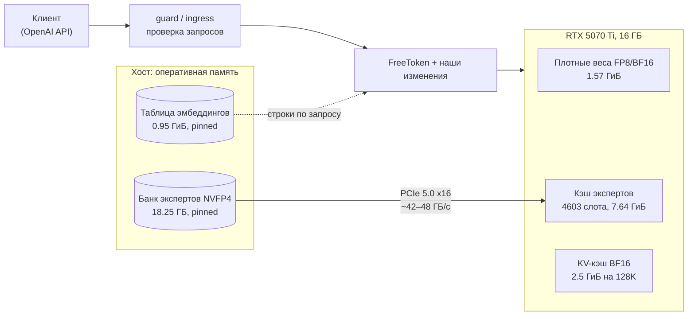

Путь одного токена по модели, места хранения весов и места, где работают рычаги релиза main128 (схема редактируется в draw.io: [`docs/model-blocks.drawio`](docs/model-blocks.drawio), генератор — [`tools/model-diagram.py`](tools/model-diagram.py)):

<picture>
  <source media="(prefers-color-scheme: dark)" srcset="docs/img/model-blocks-dark.svg">
  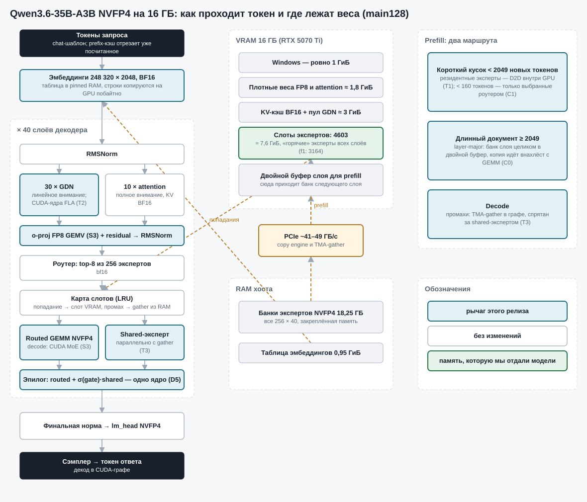
</picture>

В исходном FreeToken такая схема работает, но медленно:
- prefill гоняет банк экспертов по PCIe **на каждый чанк** промпта: на промпт 120K это ~1 ТБ трафика;
- MoE считается Triton-ядром, которое на этой архитектуре упирается в L1/TEX;
- в decode каждый промах кэша экспертов копируется медленным ядром.

Мы переписали эти узкие места так, чтобы **результат не изменился ни в одном бите**. Работа шла двумя выпусками: **f1** (14.10.2026) переделал prefill и ядра, **main128** (16.10.2026) добавил к f1 девять рычагов, ускоряющих decode, короткие запросы и использование памяти.

---

## Главные результаты

**С чем сравниваем.** В каждом главном результате три точки:

1. **исходный FreeToken** — самый первый замер на «голом» FreeToken (раздел 1 — механика исходного FreeToken с FP32-исправлением масштабов, раздел 2 — исходный FreeToken с FP16-масштабами, раздел 3 — механика исходного FreeToken на 250K);
2. **f1** — прошлый выпуск (14.10.2026), установленный рантайм f1;
3. **main128** — текущий выпуск (16.10.2026).

**f1 и f1L0 — не одно и то же.** f1 — прошлый выпуск. **f1L0** — настройки f1 (профиль `main-release`), запущенные на новом коде дерева main128 без рычагов: в код попали общие правки, не включаемые флагами. Числа близки, но не равны. На 120K в одной сессии 16.10: f1 — TTFT 20.54 с, декод 102.8 ток/с; f1L0 — 20.52 с и 103.5 ток/с. На коротких запросах f1L0 быстрее f1 на 4–7% по TTFT и на 0.5–2.7% по декоду (3 пары); контрольная пара (f1 против собственного алиаса, тот же конфиг под другим именем) разошлась на 5–7% по TTFT коротких запросов, а первая пара матрицы f1 была заметно медленнее остальных (0.477 против 0.399 с на промпте из 64 токенов), поэтому вклад общих правок кода по TTFT коротких запросов считаем ориентировочным. Сравнения «main128 против f1» построены от настоящего f1, а f1L0 используется только там, где он подписан: релизный A/B на 5 пар, лесенка рычагов и профиль Nsight.

**Как получены цифры main128 против исходного.** Исходный FreeToken заново не мерили (решение владельца). f1 и main128 сняты 16.10 **двумя матрицами подряд в одной сессии** с одинаковым протоколом (прогрев 60 с, ответ 128 токенов, чередование порядка, по 3 пары в каждой; матрицы `s5-f1old` и `s5-f1new`, данные — [`ab-f1old.json`](results/ladder/ab-f1old.json), [`ab-f1new.json`](results/ladder/ab-f1new.json)). Это не одна парная матрица: отношение «main128 / f1» — медиана main128 из второй матрицы, делённая на медиану f1 из первой, и доверительных интервалов у него нет. Абсолютные числа f1 в старой матрице (13–14.10) и 16.10 различаются (условия сессий); в цепочке используются только отношения внутри сессий: `main128 = f1 из старой матрицы × (main128 / f1 16.10)`, а множитель против исходного — `(исходный / f1 в старой матрице) × (f1 16.10 / main128 16.10)`. Это не прямой замер main128 против исходного. Сырые замеры 16.10 приведены ниже, релизный A/B на 5 пар (f1L0 против main128, `compare-ab` — PASS) — отдельной таблицей.

Знак † — для длины 64K в матрицах 16.10 точки нет; отношение main128/f1 взято из двух 2-часовых soak (f1 14.10 и main128 15–16.10; они сняты в разные дни, и отношение декода по ним на 4–6% выше, чем в матрицах 16.10 на соседних длинах: ×1.31 против ×1.23 на 16K и ×1.21 против ×1.17 на 120K), поэтому декод на 64K, вероятно, завышен на ту же величину.

Самое грубое место цепочки — промпт из 64 токенов: f1 в сессии 16.10 в 1.9 раза быстрее, чем в старой матрице (0.41 против 0.79 с), а первая пара матрицы f1 была медленной, поэтому множитель main128/f1 по TTFT там ×2.0 против ×1.93 относительно f1L0 (две матрицы) и ×1.98 в релизном A/B на 5 пар. Приведённое значение main128 (0.39 с) консервативно; прямой замер main128 16.10 — 0.200 с (см. сырые замеры ниже).

### 1. Парная матрица на 128K: исходный FreeToken → f1 → main128

База `bf128` — механика исходного FreeToken: Triton NVFP4 MoE, чанк 2048, KV в BF16, контекст 131072, плюс исправление FP32-масштабов (см. [«Гарантия качества»](#гарантия-качества)). Протокол матрицы 13–14.10 (исходный → f1): 5 парных раундов в чередующемся порядке, ровно 128 токенов ответа, одна сессия, медианы. Протокол сравнения f1 → main128 (16.10): две матрицы подряд, по 3 пары, прогрев 60 с, 128 токенов ответа, без профайлера.

**Время до первого токена (TTFT):**

| Случай | Исходный FreeToken | f1 | **main128** | main128 против f1 | main128 против исходного |
|---|---:|---:|---:|---:|---:|
| Промпт 64 токена | 0.75 с | 0.79 с | **0.39 с** | ×2.0 | **×1.93** |
| Свежий 4K | 2.24 с | 0.77 с | **0.69 с** | ×1.11 | **×3.2** |
| Свежий 16K | 6.78 с | 1.59 с | **1.55 с** | ×1.03 | **×4.4** |
| Свежий 64K† | 28.46 с | 9.14 с | **8.89 с** | ×1.03 | **×3.2** |
| Свежий 120K | 54.77 с | 22.07 с | **21.89 с** | ×1.01 | **×2.5** |
| Продолжение диалога, 4K | 2.20 с | 0.78 с | **0.49 с** | ×1.60 | **×4.5** |
| Правка последнего сообщения, 16K | 6.85 с | 0.78 с | **0.56 с** | ×1.40 | **×12** |
| Правка результата инструмента, 16K | 7.11 с | 0.76 с | **0.27 с** | ×2.8 | **×26** |

**Скорость генерации, токенов в секунду:**

| Случай | Исходный FreeToken | f1 | **main128** | main128 против f1 | main128 против исходного |
|---|---:|---:|---:|---:|---:|
| Промпт 64 токена | 96.4 | 122.8 | **146.9** | +20% | **+52%** |
| Свежий 4K | 98.9 | 124.5 | **155.0** | +25% | **+57%** |
| Свежий 16K | 94.2 | 119.1 | **146.7** | +23% | **+56%** |
| Свежий 64K† | 84.4 | 99.3 | **124.4** | +25% | **+47%** |
| Свежий 120K | 80.7 | 94.6 | **110.6** | +17% | **+37%** |
| Продолжение диалога, 4K | 106.4 | 126.9 | **160.0** | +26% | **+50%** |
| Правка последнего сообщения, 16K | 90.4 | 112.4 | **146.7** | +31% | **+62%** |
| Правка результата инструмента, 16K | 94.9 | 113.4 | **147.0** | +30% | **+55%** |

**Весь запрос (отправка → последний токен), множитель ускорения:**

| Случай | Исходный → f1 (матрица 13–14.10, геом. среднее парных) | f1 → main128 (матрицы 16.10, отношение медиан) | Исходный → main128 |
|---|---:|---:|---:|
| Промпт 64 токена | ×1.13 | ×1.38 | **×1.56** |
| Свежий 4K | ×1.95 | ×1.18 | **×2.30** |
| Свежий 16K | ×3.03 | ×1.10 | **×3.33** |
| Свежий 64K† | ×2.86 | — | — |
| Свежий 120K | ×2.45 | ×1.02 | **×2.48** |
| Продолжение диалога, 4K | ×1.91 | ×1.39 | **×2.65** |
| Правка последнего сообщения, 16K | ×4.44 | ×1.32 | **×5.88** |
| Правка результата инструмента, 16K | ×4.49 | ×1.53 | **×6.86** |
| Цикл вызова инструмента (вся задача) | ×1.08 (0.97–1.20) | — | — |

В колонке «исходный → f1» стоит геометрическое среднее парных отношений матрицы 13–14.10, в колонке «f1 → main128» — отношение медиан двух матриц 16.10 (3 пары, без интервала). Для цикла вызова инструмента (вся задача) в матрицах 16.10 замера нет, а прежний множитель f1 против базы (×1.08) имеет широкий интервал (0.97–1.20, ответ до естественного конца); единственное сравнение для него — релизный A/B f1L0 → main128 (×1.76, таблица ниже), цепочку против исходного для него не строим. Для 64K полный запрос не приводим: в soak такого парного замера нет.

**Вердикты.** f1 против исходного: **PASS** — не хуже базы во всех 9 гейтовых случаях, выигрыш ≥ 5% держится с поправкой Бонферрони. main128 против f1L0 (релизный A/B на 5 пар, `harness/compare-ab.py`): **PASS** — не хуже f1L0 во всех 9 гейтовых случаях (нижняя граница 95% ДИ ≥ 0.971), выигрыш ≥ 5% с поправкой Бонферрони подтверждён в 8 из 9 (кроме свежего промпта 120K: там ×1.015, потому что 20.4 из 21.4 с — prefill, упирающийся в тензорные ядра attention). Тексты ответов в A/B f1L0 ↔ main128 совпали в 40 из 40 случаев (жадная генерация; это наблюдение, качество гейтится отдельно). Сравнение main128 с настоящим f1 вердикта `compare-ab` не имеет: матрицы непарные.

<picture>
  <source media="(prefers-color-scheme: dark)" srcset="docs/img/ttft-128k-dark.svg">
  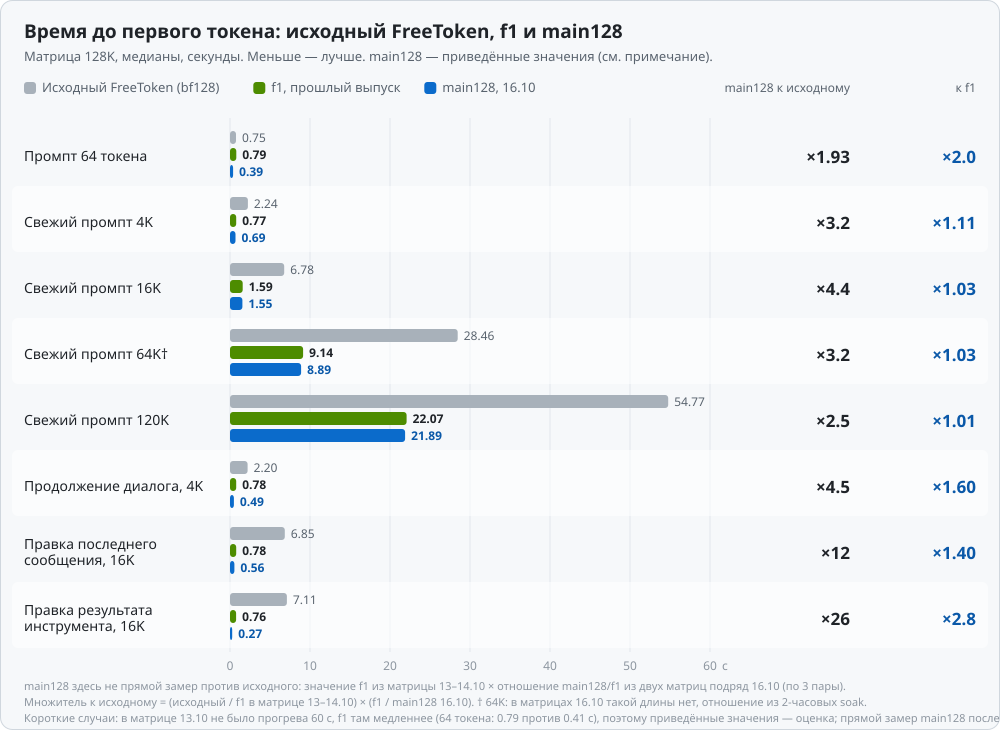
</picture>

<picture>
  <source media="(prefers-color-scheme: dark)" srcset="docs/img/decode-128k-dark.svg">
  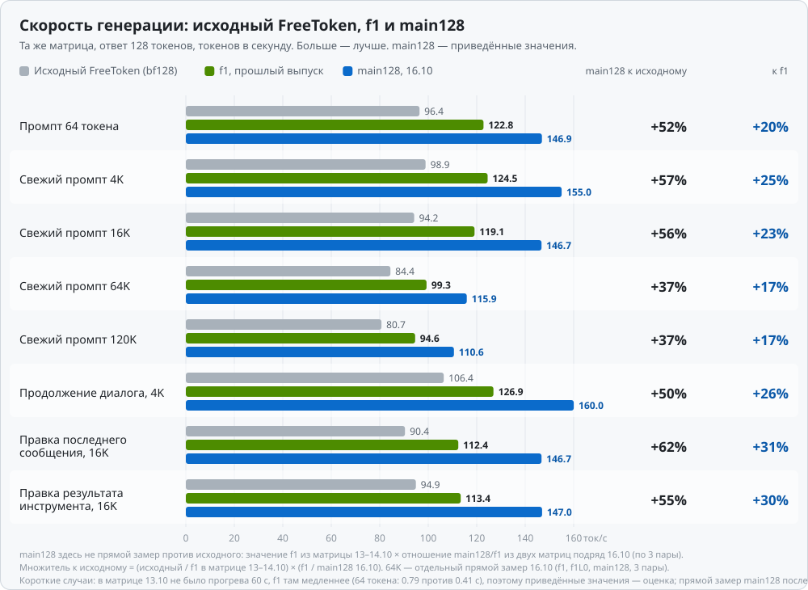
</picture>

Та же скорость генерации по длине свежего промпта, до 250K (на 250K у исходной механики замера нет, точка не нарисована):

<picture>
  <source media="(prefers-color-scheme: dark)" srcset="docs/img/decode-length-dark.svg">
  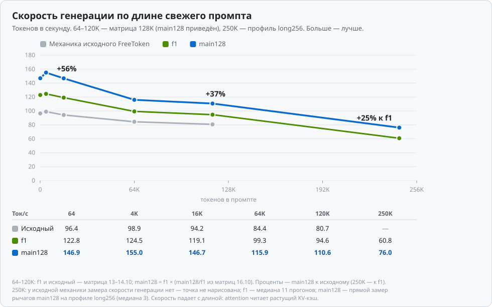
</picture>

**Релизный A/B: f1L0 (настройки f1 на новом коде) против main128, 5 пар, `compare-ab` — PASS.** Это доказательство релиза: геометрическое среднее парных отношений и 95% доверительный интервал.

| Случай | TTFT, ×(ДИ 95%) | Декод, ×(ДИ 95%) | **Весь запрос, ×(ДИ 95%), гейт** |
|---|---:|---:|---:|
| Промпт 64 токена | ×1.975 (1.911–2.041) | ×1.198 (1.172–1.224) | **×1.370 (1.353–1.388)** |
| Свежий 2K | ×1.058 (1.031–1.085) | ×1.252 (1.224–1.281) | **×1.181 (1.161–1.201)** |
| Свежий 4K | ×1.053 (1.032–1.074) | ×1.259 (1.248–1.270) | **×1.183 (1.176–1.191)** |
| Свежий 16K | ×1.022 (1.017–1.026) | ×1.235 (1.215–1.255) | **×1.097 (1.090–1.104)** |
| Свежий 120K | ×1.008 (1.007–1.009) | ×1.148 (1.128–1.168) | **×1.015 (1.013–1.017)** |
| Продолжение диалога, 4K | ×1.537 (1.494–1.581) | ×1.244 (1.231–1.257) | **×1.325 (1.307–1.343)** |
| Правка последнего сообщения, 16K | ×1.360 (1.308–1.414) | ×1.266 (1.238–1.294) | **×1.293 (1.264–1.321)** |
| Правка результата инструмента, 16K | ×2.684 (2.585–2.787) | ×1.272 (1.234–1.311) | **×1.514 (1.471–1.558)** |
| Цикл вызова инструмента (вся задача) | — | — | **×1.761 (1.733–1.789)** |

<details>
<summary><b>Сырые замеры 16.10: две матрицы подряд — f1, f1L0 и main128 (медиана / среднее / p95, 3 пары)</b></summary>

Матрицы `s5-f1old` (f1) и `s5-f1new` (f1L0 и main128): одна сессия, чередование порядка, прогрев 60 с, ответ 128 токенов, без профайлера. Выборка из 3 пар: p95 здесь — грубая оценка, она стремится к максимуму. Дополнительно к матрице есть свежий промпт 2K.

**TTFT**

| Случай | f1: TTFT, с | f1L0: TTFT, с | main128: TTFT, с |
|---|---:|---:|---:|
| Промпт 64 токена | 0.406 / 0.427 / 0.470 | 0.387 / 0.386 / 0.387 | **0.200 / 0.200 / 0.201** |
| Свежий 2K | 0.425 / 0.449 / 0.497 | 0.399 / 0.400 / 0.401 | **0.379 / 0.384 / 0.394** |
| Свежий 4K | 0.430 / 0.448 / 0.495 | 0.402 / 0.402 / 0.403 | **0.387 / 0.391 / 0.397** |
| Свежий 16K | 1.347 / 1.348 / 1.354 | 1.344 / 1.342 / 1.344 | **1.314 / 1.313 / 1.315** |
| Свежий 120K | 20.537 / 20.535 / 20.550 | 20.520 / 20.519 / 20.521 | **20.368 / 20.367 / 20.377** |
| Продолжение диалога, 4K | 0.405 / 0.427 / 0.469 | 0.388 / 0.388 / 0.389 | **0.254 / 0.257 / 0.262** |
| Правка последнего сообщения, 16K | 0.417 / 0.440 / 0.487 | 0.398 / 0.398 / 0.399 | **0.297 / 0.297 / 0.297** |
| Правка результата инструмента, 16K | 0.415 / 0.436 / 0.481 | 0.395 / 0.395 / 0.396 | **0.150 / 0.150 / 0.150** |

**Скорость генерации**

| Случай | f1: декод, ток/с | f1L0: декод, ток/с | main128: декод, ток/с |
|---|---:|---:|---:|
| Промпт 64 токена | 151.8 / 148.7 / 152.7 | 153.3 / 151.2 / 153.6 | **181.6 / 181.1 / 181.8** |
| Свежий 2K | 148.9 / 149.9 / 151.8 | 150.2 / 151.9 / 155.5 | **191.1 / 190.4 / 192.0** |
| Свежий 4K | 152.3 / 148.9 / 152.4 | 153.0 / 151.0 / 153.6 | **189.6 / 189.0 / 192.0** |
| Свежий 16K | 142.9 / 141.0 / 145.4 | 144.1 / 142.9 / 146.1 | **176.0 / 175.3 / 177.1** |
| Свежий 120K | 102.8 / 103.4 / 105.9 | 103.5 / 104.4 / 106.4 | **120.2 / 120.0 / 120.6** |
| Продолжение диалога, 4K | 151.1 / 149.4 / 152.5 | 154.0 / 151.4 / 154.7 | **190.5 / 188.0 / 191.1** |
| Правка последнего сообщения, 16K | 129.2 / 131.1 / 135.1 | 132.7 / 133.3 / 136.7 | **168.7 / 169.2 / 171.9** |
| Правка результата инструмента, 16K | 132.4 / 135.1 / 141.6 | 134.5 / 137.2 / 142.9 | **171.6 / 174.2 / 179.9** |

**Весь запрос**

| Случай | f1: весь запрос, с | f1L0: весь запрос, с | main128: весь запрос, с |
|---|---:|---:|---:|
| Промпт 64 токена | 1.243 / 1.283 / 1.362 | 1.216 / 1.227 / 1.249 | **0.900 / 0.901 / 0.906** |
| Свежий 2K | 1.280 / 1.296 / 1.334 | 1.247 / 1.236 / 1.249 | **1.043 / 1.052 / 1.068** |
| Свежий 4K | 1.263 / 1.302 / 1.383 | 1.230 / 1.243 / 1.266 | **1.068 / 1.063 / 1.073** |
| Свежий 16K | 2.236 / 2.250 / 2.293 | 2.227 / 2.231 / 2.258 | **2.032 / 2.038 / 2.049** |
| Свежий 120K | 21.773 / 21.765 / 21.804 | 21.749 / 21.736 / 21.749 | **21.431 / 21.426 / 21.432** |
| Продолжение диалога, 4K | 1.277 / 1.277 / 1.314 | 1.211 / 1.228 / 1.257 | **0.921 / 0.933 / 0.956** |
| Правка последнего сообщения, 16K | 1.390 / 1.409 / 1.476 | 1.356 / 1.352 / 1.374 | **1.050 / 1.048 / 1.058** |
| Правка результата инструмента, 16K | 1.363 / 1.377 / 1.453 | 1.340 / 1.322 / 1.349 | **0.891 / 0.880 / 0.896** |

</details>

<details>
<summary><b>Сырые замеры релизного A/B 16.10: f1L0 и main128 (медиана / среднее / p95, 5 пар)</b></summary>

Одна сессия, ротация порядка рук, прогрев 60 с, ответ 128 токенов, без профайлера. Выборка из 5 пар: p95 здесь — грубая оценка, она стремится к максимуму.

**TTFT**

| Случай | f1L0: TTFT, с | main128: TTFT, с | Мин–макс main128 |
|---|---:|---:|---:|
| Промпт 64 токена | 0.389 / 0.393 / 0.410 | **0.199 / 0.199 / 0.201** | 0.197–0.201 |
| Свежий 2K | 0.402 / 0.407 / 0.429 | **0.382 / 0.385 / 0.395** | 0.379–0.397 |
| Свежий 4K | 0.407 / 0.412 / 0.429 | **0.388 / 0.391 / 0.399** | 0.388–0.401 |
| Свежий 16K | 1.343 / 1.344 / 1.348 | **1.315 / 1.315 / 1.317** | 1.314–1.317 |
| Свежий 120K | 20.524 / 20.527 / 20.541 | **20.366 / 20.365 / 20.372** | 20.355–20.373 |
| Продолжение диалога, 4K | 0.391 / 0.394 / 0.411 | **0.255 / 0.256 / 0.260** | 0.253–0.261 |
| Правка последнего сообщения, 16K | 0.400 / 0.405 / 0.422 | **0.298 / 0.297 / 0.302** | 0.291–0.302 |
| Правка результата инструмента, 16K | 0.400 / 0.403 / 0.420 | **0.152 / 0.150 / 0.152** | 0.147–0.152 |

**Скорость генерации**

| Случай | f1L0: декод, ток/с | main128: декод, ток/с | Мин–макс main128 |
|---|---:|---:|---:|
| Промпт 64 токена | 153.2 / 151.9 / 153.7 | **182.2 / 181.9 / 182.6** | 180.2–182.6 |
| Свежий 2K | 151.1 / 152.4 / 156.2 | **191.2 / 190.8 / 192.1** | 188.5–192.3 |
| Свежий 4K | 150.4 / 149.6 / 153.1 | **188.8 / 188.3 / 191.9** | 184.6–192.3 |
| Свежий 16K | 143.2 / 142.2 / 145.5 | **176.4 / 175.5 / 177.5** | 172.7–177.5 |
| Свежий 120K | 106.0 / 105.3 / 107.4 | **121.0 / 120.8 / 121.6** | 119.7–121.7 |
| Продолжение диалога, 4K | 154.1 / 152.3 / 154.4 | **191.0 / 189.5 / 191.8** | 182.5–191.9 |
| Правка последнего сообщения, 16K | 136.8 / 134.5 / 137.2 | **169.4 / 170.2 / 172.6** | 167.0–172.7 |
| Правка результата инструмента, 16K | 137.8 / 138.0 / 143.8 | **175.0 / 175.5 / 180.3** | 170.5–180.5 |

**Весь запрос**

| Случай | f1L0: весь запрос, с | main128: весь запрос, с | Мин–макс main128 |
|---|---:|---:|---:|
| Промпт 64 токена | 1.219 / 1.230 / 1.253 | **0.895 / 0.897 / 0.904** | 0.893–0.905 |
| Свежий 2K | 1.241 / 1.241 / 1.279 | **1.048 / 1.051 / 1.067** | 1.042–1.072 |
| Свежий 4K | 1.267 / 1.262 / 1.280 | **1.068 / 1.066 / 1.078** | 1.048–1.079 |
| Свежий 16K | 2.234 / 2.238 / 2.258 | **2.036 / 2.039 / 2.051** | 2.031–2.053 |
| Свежий 120K | 21.721 / 21.734 / 21.776 | **21.420 / 21.416 / 21.430** | 21.403–21.431 |
| Продолжение диалога, 4K | 1.215 / 1.228 / 1.277 | **0.921 / 0.927 / 0.950** | 0.918–0.957 |
| Правка последнего сообщения, 16K | 1.327 / 1.350 / 1.402 | **1.041 / 1.044 / 1.059** | 1.033–1.060 |
| Правка результата инструмента, 16K | 1.321 / 1.325 / 1.378 | **0.878 / 0.875 / 0.896** | 0.851–0.898 |

Пик памяти процесса в A/B: 14 391 398 400 Б (13.4 ГиБ) при бюджете 16 021 192 704 Б (14.9 ГиБ = карта минус 1 ГиБ Windows); минимум свободной VRAM за прогон 1.10 ГиБ. У f1L0 пик 12.0 ГиБ при том же бюджете: модель теперь использует память до бюджета, как и задумано правилом владельца.

</details>

### 2. Одинаковые условия на 64K

Чтобы сравнить с самыми первыми замерами исходного FreeToken, три варианта были прогнаны в одной сессии (13–14.10): контекст 65536, ответ 192 токена, прогрев 60 с, 2 раунда в обратном порядке. В ячейках TTFT / decode (ток/с). Значение main128 приведено цепочкой (f1 из этой таблицы × отношение main128/f1 из двух матриц подряд 16.10 на 128K; для 60K — отношение из soak, †).

| Промпт | Исходный FreeToken (FP16-масштабы) | + исправление FP32 | f1 | **main128** | main128 против f1 | main128 против исходного |
|---|---:|---:|---:|---:|---|---|
| 4K | 1.93 с / 116.0 | 1.85 с / 118.1 | 0.58 с / 142.4 | **0.52 с / 177.3** | TTFT ×1.11, decode +25% | TTFT **×3.7**, decode **+53%** |
| 16K | 6.04 с / 111.3 | 5.86 с / 115.7 | 1.49 с / 138.0 | **1.45 с / 170.0** | TTFT ×1.03, decode +23% | TTFT **×4.2**, decode **+53%** |
| 60K† | 22.86 с / 101.3 | 22.43 с / 107.6 | 7.50 с / 122.2 | **7.30 с / 153.0** | TTFT ×1.03, decode +25% | TTFT **×3.1**, decode **+51%** |

Раунды f1 расходятся меньше чем на 0.3%. Исправление FP32-масштабов decode не замедлило.

### 3. Длинный контекст (профиль `long256`, 262 144 токена)

| Замер | Исходная механика FreeToken | f1 | long256 без рычагов (новое дерево) | **long256 + рычаги main128** | main128 против f1 | main128 против исходного |
|---|---:|---:|---:|---:|---:|---:|
| Свежий промпт 250K, TTFT | 126.5 с (13.10, Triton, чанк 4096, 1 прогон) | 77.4 с (медиана 11) | 72.7 с | **72.3 с** | ×1.07 | **×1.75** |
| Свежий промпт 250K, decode | — | 60.8 ток/с | 67.3 | **76.0** | +25% | — |
| Промпт 261 468 токенов (предел контекста), TTFT | 139.5 с (медиана 5) | 91.3 с (1 прогон) | 78.7 с | **78.3 с** | ×1.17 | **×1.78** |
| То же, decode | ≈52.5 ток/с | 52.5 ток/с | 67.5 | **73.6** | +40% | +40% |
| Свежий промпт 120K на профиле long256, TTFT | — | — | 20.5 с | **20.4 с** | — | — |
| Свежий промпт 120K на профиле long256, decode | — | — | 89.0 | **105.8** | — | — |
| Продолжение диалога на 250K (кэш префиксов) | — | 1.06 с, попаданий 11/11 | — | — | — | — |

Все числа этой таблицы получены в разных сессиях и не являются парными раундами. Рычаги main128 на 262 144 токена мерились как статистика (3 повтора, `memory_ratio` 0.73, без teacher), в штатный профиль `long256` они не включены. Важно читать так: на 250K TTFT с рычагами (72.3 с) почти равен TTFT без рычагов на том же дереве (72.7 с), то есть выигрыш против f1 по TTFT (77.4 с) даёт не рычаг, а дерево или сессия; рычаги дают декод: 76.0 против 67.3 ток/с (+13%). Предел контекста: промпт 261 468 токенов проходит, +1 токен отвечает 400 `context_length_exceeded`.

Почему 250K стоит в 3.5 раза дороже, чем 120K, при вдвое большей длине: attention квадратичен. На 120K он занимает ~66% prefill (по Nsight Systems), и его доля растёт с длиной.

<picture>
  <source media="(prefers-color-scheme: dark)" srcset="docs/img/ttft-length-dark.svg">
  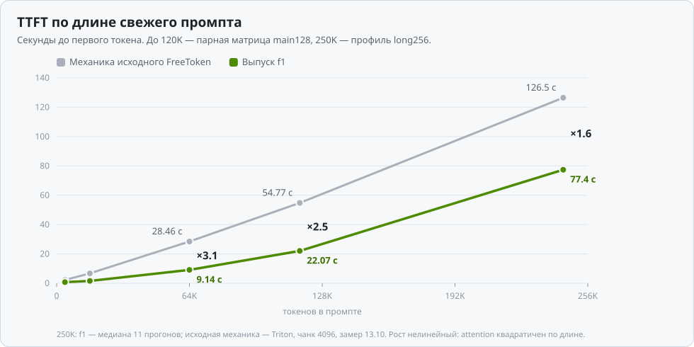
</picture>

### 4. Задержки под длительной нагрузкой (soak 2 часа, ответ 256 токенов)

Soak main128 (15–16.10.2026): 7 210 с, 549 итераций, **800/800 проверок**, 891 запрос клиента, 0 ошибок, 0 зависаний. Нагрузка та же, что у soak f1 (14.10.2026), её хеш совпадает: свежие промпты 64 / 4K / 16K / 64K / 120K, ответ 256 токенов, температура 0.6, пауза 5 с между запросами; в ротацию входят продолжения диалога, арифметические проверки, циклы вызова инструмента и отмены посреди ответа. Запросов на каждую длину: 110 (на 120K — 109).

| Промпт | Запросов | TTFT p50 | TTFT p90 | TTFT p99 | Prefill, ток/с | Decode p50 | Decode p10 | Мс на токен |
|---:|---:|---:|---:|---:|---:|---:|---:|---:|
| 93 токена | 110 | 0.22 с | 0.32 с | 0.47 с | 414 | 181.7 | 176.1 | 5.5 |
| 4K | 110 | 0.51 с | 0.51 с | 0.67 с | 8 148 | 179.7 | 175.0 | 5.6 |
| 16K | 110 | 1.33 с | 1.35 с | 1.64 с | 12 295 | 170.2 | 167.8 | 5.9 |
| 64K | 110 | 7.92 с | 7.95 с | 8.19 с | 8 280 | 140.5 | 138.6 | 7.1 |
| 120K | 109 | 20.39 с | 20.45 с | 20.71 с | 5 886 | 118.1 | 117.0 | 8.5 |

Сравнение с soak f1 (запросов на длину 102, на 120K — 101):

| Промпт | TTFT p50: f1 → main128 | TTFT p99: f1 → main128 | Decode p50: f1 → main128 | Мс на токен: f1 → main128 |
|---:|---:|---:|---:|---:|
| 93 токена | 0.60 → **0.22 с** | 0.67 → **0.47 с** | 133.7 → **181.7** (+36%) | 7.5 → **5.5** |
| 4K | 0.61 → **0.51 с** | 0.65 → **0.67 с** | 135.0 → **179.7** (+33%) | 7.4 → **5.6** |
| 16K | 1.36 → **1.33 с** | 1.61 → **1.64 с** | 129.8 → **170.2** (+31%) | 7.7 → **5.9** |
| 64K | 8.14 → **7.92 с** | 9.29 → **8.19 с** | 112.2 → **140.5** (+25%) | 8.9 → **7.1** |
| 120K | 20.97 → **20.39 с** | 22.92 → **20.71 с** | 97.5 → **118.1** (+21%) | 10.3 → **8.5** |

Прирост в декоде в soak больше, чем в матрицах 16.10 (+31% против +23% на 16K), потому что soak f1 снят днём раньше в другом состоянии системы (f1 в soak: 129.8 ток/с на 16K, f1 в матрице 16.10: 142.9). TTFT p99 на 4K и 16K у main128 чуть выше (0.67 против 0.65 с и 1.64 против 1.61 с) — в пределах разброса. TTFT в soak выше, чем в матрицах (на 4K 0.51 против 0.39 с): другой протокол (температура 0.6, паузы между запросами), сравнивать надо soak с soak.

| Проверка soak | f1 | main128 |
|---|---:|---:|
| Продолжения диалога (кэш префиксов), попаданий | 102/102, 91.6% токенов из кэша | 110/110, 91.6% токенов из кэша |
| TTFT продолжения диалога 4K, p50 | 0.59 с | **0.33 с** |
| Готов к следующему запросу после отмены, медиана (макс) | 1.45 с (1.61) | **0.47 с (0.48)** |
| Арифметика / циклы инструмента / отмены | 73 / 30 / 27, все пройдены | 79 / 33 / 29, все пройдены |

Свободная VRAM в soak: минимум **1.04 ГиБ**, медиана 1.09 ГиБ, **0 замеров ниже 0.8 ГиБ** из 720 (у f1: минимум 0.43 ГиБ, 127 из 721 замеров ниже 0.8 ГиБ, около 21 минуты). Подкачки нет: разделяемая память GPU в Windows за 2 часа выросла на 30 МиБ (порог гейта 256 МиБ). Память хоста: подробности в разделе [«Память и KV-кэш»](#память-и-kv-кэш).

---

## Что именно мы сделали

Все изменения **побитово точные**: каждое выдаёт ровно те же байты, что исходная реализация, и проходило гейт отдельно.

### Выпуск f1: перестроенный prefill и CUDA-ядра

Главная идея f1 — **послойный prefill**. Порядок вычислений меняется, а сами вычисления нет:

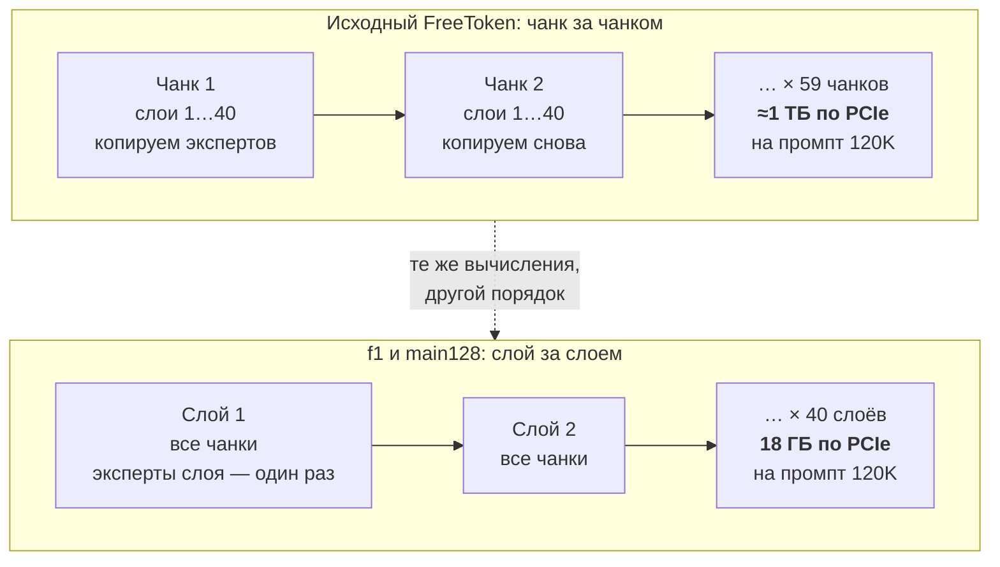

Каждая задача (слой L, чанк k) зависит только от (слой L−1, чанк k) и (слой L, чанк k−1). Поэтому порядок «слой за слоем» допустим и даёт побитово тот же результат, а копирование следующего слоя экспертов прячется за вычислениями текущего.

| Изменение f1 | Суть | Эффект |
|---|---|---|
| **Побитово точный CUDA MoE для prefill** | Своё CUDA-ядро NVFP4 MoE вместо Triton. Повторяет порядок вычислений исходного ядра, поэтому результат побитово тот же | Слой ×7.25; TTFT 120K 57.8 → ~37 с |
| **Послойный (layer-major) prefill** | Вместо «все слои для чанка, потом следующий чанк» — «один слой для всех чанков, потом следующий слой». Каждый слой экспертов копируется по PCIe **один раз на промпт**, а не на каждый чанк | PCIe на промпт 120K: **1076 → 18 ГБ**; TTFT 120K → 25.6 с, 250K 134 → 90 с |
| **GDN на CUDA** | Слои Gated DeltaNet (линейный attention в Qwen3.6): слитые ядра conv + SiLU + L2, gate cumsum, gated norm, decode за один запуск | TTFT −6…9% |
| **FP8 GEMV (QMMA)** | Своё ядро матрица×вектор на FP8 tensor cores для проекций в decode | decode +8…12% |
| **TMA gather экспертов** | Подкачка промахнувшихся экспертов в decode через `cp.async.bulk`, на ~42 ГБ/с (у потолка канала) | decode +4.8…5.6% |
| **Пакетный attention** | В послойном prefill attention считается сразу для пар чанков, что лучше заполняет GPU и убирает «хвост волны» | TTFT −3…8% |
| **THP для банка экспертов** | `MAP_PRIVATE` + `MADV_HUGEPAGE`: на разделяемой памяти WSL huge pages не работали | TTFT −2…4%, decode +2…6% |
| **GLIBC_TUNABLES** | `arena_max=2`, пороги mmap/trim | рост памяти за 2 ч: **+394 → +48 МБ** |

### Выпуск main128: девять рычагов поверх f1

Каждый рычаг включается своим флагом профиля и проверен на побитовую точность отдельно: teacher 125/125, `max_abs` 0. Конфиг прогонов — [`harness/main-release-next-d5.json`](harness/main-release-next-d5.json), профиль — `main128` в [`serving/profiles.json`](serving/profiles.json), полный список модулей и переключателей — [`freetoken/MODIFICATIONS.md`](freetoken/MODIFICATIONS.md). В последней колонке — флаг профиля, переменная окружения и (мелко, в скобках) внутренний код рычага, которым он подписан в данных `results/ladder/*.json`.

| Рычаг | Что делает | Флаг профиля → переменная окружения (код) |
|---|---|---|
| **Короткий маршрут prefill: эксперты из VRAM копируются внутри GPU** | Эксперты, уже лежащие в слотах, копируются в буфер prefill внутри GPU, а не по PCIe. Послойный prefill включается только с 2049 некэшированных токенов, короче идёт чанковый путь | `--moe-prefill-hit-d2d`, `layer_major_min_tokens: 2049` → `QWEN36_LAYER_MAJOR_MIN_TOKENS=2049` (T1) |
| **CUDA-ядра GDN для prefill** | Слитые побитово точные CUDA-ядра FLA-чанка GDN (вариант `wu`) вместо набора мелких ядер | `cuda_gdn_fla: "wu"` → `QWEN36_CUDA_GDN_FLA=wu` (T2) |
| **Shared-эксперт параллельно с подкачкой промахов** | Gather промахов decode идёт на побочном потоке и перекрывается с расчётом общего (shared) эксперта того же слоя; объединение по событию внутри CUDA graph | `decode_shared_overlap` → `QWEN36_DECODE_SHARED_OVERLAP=1` (T3) |
| **Эмбеддинги в закреплённой RAM хоста** | Таблица эмбеддингов (0.95 ГиБ) уходит в pinned-память хоста, освободившаяся VRAM — под слоты экспертов | `host_embeddings` → `QWEN36_HOST_EMBEDDINGS=1` |
| **Больше слотов экспертов** | `memory_ratio` 0.75 → 0.85: слотов 3729 → 4611 (3729 — после эмбеддингов в RAM, до них было 3164) | `memory_ratio: 0.85` |
| **Бит-точные CUDA-ядра декода: o-proj и MoE** | Побитовая копия cuBLASLt split-K для 40 o-проекций (M 1..8) и CUDA GEMV вместо Triton для gate_up/down экспертов | `cuda_oproj_gemv` → `QWEN36_OPROJ_GEMV=1` + `libqwen_oproj_gemv.so`; `cuda_moe_decode` → `QWEN36_MOE_DECODE_CUDA=1` + `libqwen_moe_decode.so` (S3) |
| **Копирование экспертов без ожидания GEMM** | Поток копирования prefill получает высший приоритет, а 6 мелких ядер инвалидации перед копией каждого слоя заменены одной инвалидацией на эпоху | `prefill_copy_priority` → `QWEN36_PREFILL_COPY_PRIORITY=1`, `QWEN36_PREFILL_EPOCH_INVALIDATE=1` (C0) |
| **Короткие куски везут только выбранных роутером экспертов** | Чанк короче 160 токенов копирует не весь слой, а только выбранных роутером экспертов (резидентные — внутри GPU, остальные — TMA gather с хоста) | `prefill_selected: 160` → `QWEN36_PREFILL_SELECTED=160` (нужен `decode_gather`) (C1) |
| **Слитый эпилог MoE-блока** | Три мелких bf16-ядра на слой (sigmoid(gate), shared·sig, routed + prod) заменены одним ядром с теми же округлениями, что у torch; −80 запусков на шаг | `decode_shared_epilogue` → `QWEN36_DECODE_SHARED_EPILOGUE=1` (D5) |

Какой путь выбирает prefill, зависит от числа некэшированных токенов:

| Некэшированных токенов | Путь prefill | Что едет по PCIe |
|---|---|---|
| меньше 160 | чанковый, только выбранные эксперты | эксперты, выбранные роутером; уже лежащие в VRAM копируются внутри GPU |
| 160 … 2048 | чанковый | весь слой экспертов; резидентные эксперты (~23%) копируются внутри GPU |
| от 2049 | послойный (layer-major) | каждый слой экспертов один раз на весь промпт |

**Ядра декода (код — [`kernels/decode-oproj/`](kernels/decode-oproj/) и [`kernels/decode-moe/`](kernels/decode-moe/)).**
- *o-проекция.* cuBLASLt считает её split-K = 3 (memset + одно xmma-ядро). Мы повторили его арифметику бит в бит (см. [«Найденные ошибки»](#найденные-ошибки-и-подводные-камни)). На графе проекция стала быстрее: 17.4 → 12.1–12.5 мкс на M = 1 (~0.2 мс на шаг, ядро читает веса на ~690 ГБ/с). Проверено 832 случая × 6 вариантов, 0 расхождений (96 синтетических и 736 на реальных весах всех 40 слоёв, M 1..8, eager и в CUDA graph).
- *MoE decode.* Повторяет порядок вычислений Triton-ядра (16 частичных сумм, дерево редукции через shuffle) с другой раскладкой чтения. M = 1, gate_up + down: 28.4 → 20.5 мкс на слой (~0.32 мс на шаг); gate_up читает ~720 ГБ/с, down ~600 ГБ/с. Проверено 4284 сравнения, 0 расхождений; весь MoE-блок с подменой побайтно совпал в 21 случае.
- *Модельный A/B ядер* (3 раунда, 64-токенный и 16K промпты): только o-проекция +2.1% / +1.7% декода, только MoE +4.9% / +4.6%, оба +8.6% / +7.6%; тексты побайтно одинаковы во всех 12 запусках сервера.
- *Защита.* Библиотеки подгружаются из запечатанного memfd только при совпадении sha256; при загрузке идёт побитовая самопроверка (M 1..8, граничные значения) и проверка на реальных весах каждого слоя; при несовпадении этот M остаётся на cuBLASLt/Triton. Первый запуск каждого варианта в свежем процессе занял 0 МиБ VRAM.

Как выглядит один шаг decode в main128. Шаг записан в CUDA graph целиком. Каждый из 40 слоёв выбирает 8 экспертов из 256. Тех, кого нет в слотах VRAM, подкачивает наше TMA-ядро прямо из закреплённой памяти хоста; пока идёт подкачка, GPU считает общий эксперт того же слоя:

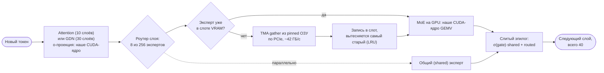

Промахов кэша на токен на 16K стало 12.4 вместо 27.7 (слотов 4603 вместо 3164), подкачка занимает 0.64 мс из 5.78 мс шага (было 1.08 из 7.07). Канал при этом по-прежнему на пределе, поэтому рычаги прячут копию за счётом и уменьшают её объём, а не ускоряют сам канал.

Как это выглядит на таймлайне Nsight Systems. Копия экспертов одного слоя (~456 МБ) занимает ~8–10 мс. На длинном промпте она теряется за сотнями миллисекунд счёта слоя. На коротком промпте всё наоборот: копия дольше счёта, и GPU ждёт PCIe. Это нижняя граница TTFT: рычаги main128 (короткий маршрут и выбор экспертов) её снизили, но не убрали совсем.

<picture>
  <source media="(prefers-color-scheme: dark)" srcset="docs/img/prefill-timeline-dark.svg">
  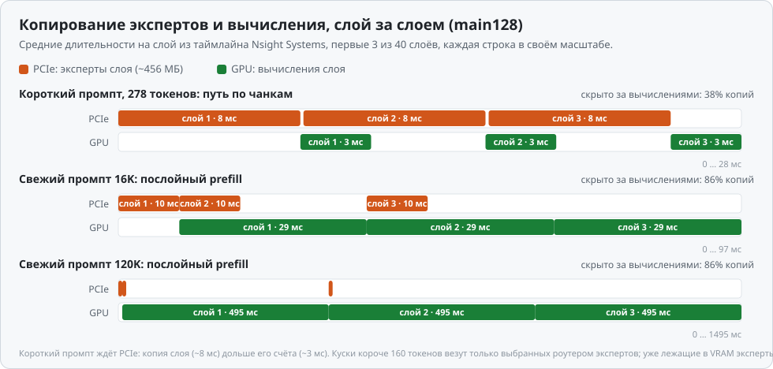
</picture>

**Не вошло**, хотя было реализовано и замерено:

| Что | Результат | Почему не вошло | Код в данных |
|---|---|---|---|
| **Предвыборка экспертов на слой вперёд** | декод −4% в лесенке: 169.2 против 176.4 ток/с на 16K, 118.2 против 120.5 на 120K | не окупается. Вариант со своим приоритетным потоком (`QWEN36_DECODE_PREGATE_PRIORITY=1`, выключен) на микробенче прячет 44–92% копии, но на модели не мерился: см. [«Что дальше»](#что-дальше) | D3b |
| **Прогрев слотов из prefill** | декод 16K 173.7 против 176.4, TTFT 64 токена 0.205 против 0.201 с; на микробенче первые 8 токенов быстрее на 0.6–0.9 мс | без выигрыша на модели | D6 |
| **Копирование через TMA вместо copy engine** | TTFT на 3–36% хуже в 3 парах | после перестройки очереди copy engine даёт ~49 ГБ/с против ~35 у TMA | C2 |
| **FP8 KV-кэш** | decode +26…46% (замер на f1), но TTFT свежих длинных промптов хуже на 26–33% и теряется побитовая точность | отложено | — |
| **Refill кэша после prefill** и **sync-lean** | +0.1…0.5%, ниже шума | не нужны | — |
| **MTP / спекулятивный декодинг и vision** | — | не нужны по решению владельца | — |

---

## Что дал каждый рычаг

Лесенка: каждая ступень — предыдущая плюс один рычаг, 3 пары, прогрев 60 с, ответ 128 токенов. В ячейках: медиана (среднее). При n = 3 перцентили p95/p99 стремятся к максимуму и ничего не добавляют, поэтому их нет; полные статистики (min–max, p95, p99, n) лежат в [`results/ladder/summary.json`](results/ladder/summary.json). **Каждая ступень прошла teacher-гейт 125/125 с `max_abs` 0.**

Первая строка — f1 (прошлый выпуск, установленный рантайм) из отдельной матрицы той же сессии 16.10 ([`ab-f1old.json`](results/ladder/ab-f1old.json)). Вторая — f1L0: настройки f1 на новом коде, база лесенки ([`ab.json`](results/ladder/ab.json)); её разница с f1 — вклад общих правок кода дерева без рычагов. Строки сняты в разных матрицах, поэтому разницу f1L0 к f1 нужно читать как ориентировочную.

| Ступень | TTFT 64, с | TTFT 16K, с | Декод 16K, ток/с | Декод 120K, ток/с | Слоты | Промахов на токен (16K) |
|---|---:|---:|---:|---:|---:|---:|
| **f1 (прошлый выпуск, установленный рантайм)** | 0.406 (0.427) | 1.347 (1.348) | 142.9 (141.0) | 102.8 (103.4) | 3164 | 27.7 |
| f1L0: настройки f1 на новом коде | 0.390 (0.399) | 1.344 (1.345) | 143.4 (142.2) | 103.1 (103.8) | 3164 | 27.7 |
| + короткий маршрут prefill | 0.315 (0.312) | 1.343 (1.343) | 143.9 (142.9) | 103.5 (104.5) | 3164 | 27.7 |
| + CUDA-ядра GDN для prefill | 0.317 (0.319) | 1.316 (1.315) | 143.6 (142.0) | 103.4 (103.7) | 3164 | 27.7 |
| + shared-эксперт параллельно с подкачкой | 0.304 (0.310) | 1.330 (1.347) | 148.6 (144.9) | 106.1 (104.9) | 3164 | 27.7 |
| + эмбеддинги в RAM хоста | 0.314 (0.305) | 1.319 (1.320) | 153.8 (151.7) | 108.9 (108.4) | 3729 | 19.9 |
| + больше слотов экспертов (`memory_ratio` 0.85) | 0.259 (0.261) | 1.315 (1.316) | 159.5 (158.9) | 112.1 (111.7) | 4611 | 12.3 |
| + бит-точные ядра декода (o-proj и MoE) | 0.270 (0.287) | 1.321 (1.347) | 170.3 (169.2) | 118.4 (117.3) | 4603 | 12.5 |
| + копирование без ожидания GEMM | 0.252 (0.254) | 1.315 (1.316) | 171.7 (172.3) | 118.4 (118.7) | 4603 | 12.5 |
| + короткие куски: только выбранные эксперты | 0.207 (0.205) | 1.323 (1.322) | 173.8 (172.1) | 119.5 (118.5) | 4603 | 12.7 |
| **+ слитый эпилог MoE-блока = main128** | **0.201 (0.201)** | **1.318 (1.318)** | **176.4 (175.4)** | **120.5 (120.3)** | **4603** | **12.4** |

Разница f1L0 к f1 (медианы лесенки к медианам f1): TTFT 64 токенов −0.016 с (0.406 → 0.390; в той же сессии, что f1, — 0.387), TTFT 16K −0.003 с, декод 16K +0.5 ток/с (+0.4%), декод 120K +0.3 ток/с (+0.3%). Это в пределах разброса 3 пар; на промпте из 64 токенов разница сопоставима с разбросом самого f1 (первая пара его матрицы медленнее остальных).

<picture>
  <source media="(prefers-color-scheme: dark)" srcset="docs/img/ladder-decode16k-dark.svg">
  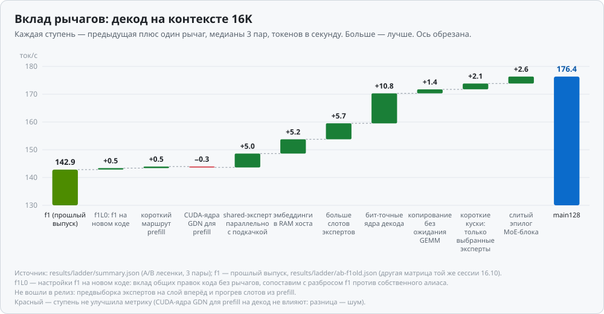
</picture>

<picture>
  <source media="(prefers-color-scheme: dark)" srcset="docs/img/ladder-ttft64-dark.svg">
  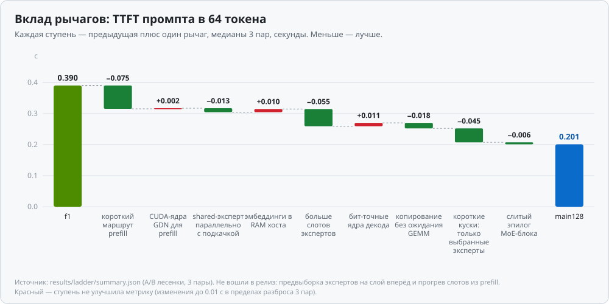
</picture>

Что показывает лесенка:
- **Прирост даёт декод, а не TTFT длинных промптов.** В лесенке на 16K декод вырос с 143.4 (f1L0) до 176.4 ток/с (+23%), на 120K — с 103.1 до 120.5 (+17%). То же против настоящего f1 в двух матрицах подряд: 142.9 → 176.0 ток/с на 16K (+23%) и 102.8 → 120.2 на 120K (+17%). TTFT на 16K и 120K почти не меняется (1.32 с и 20.4 с): prefill там упирается в тензорные ядра attention, а копия экспертов уже спрятана. TTFT коротких запросов падает с 0.39 (f1L0; f1 — 0.41) до 0.20 с.
- **Вклад рычагов в декод 16K, ток/с** (от f1L0): короткий маршрут prefill +0.5, CUDA-ядра GDN для prefill −0.3 (шум: этот рычаг про prefill), shared-эксперт параллельно с подкачкой +5.0, эмбеддинги в RAM +5.2, больше слотов +5.7, бит-точные ядра декода +10.8, копирование без ожидания GEMM +1.4, короткие куски с выбранными экспертами +2.1, слитый эпилог +2.6.
- **Вклад рычагов в TTFT 64 токенов, с:** короткий маршрут prefill −0.075, больше слотов −0.055, короткие куски с выбранными экспертами −0.045, копирование без ожидания GEMM −0.018, shared-эксперт параллельно с подкачкой −0.013, слитый эпилог −0.006; остальные ступени в пределах шума 3 пар (±0.01 с).
- **CUDA-ядра GDN для prefill** дают −2% TTFT на 16K (1.343 → 1.316 с) и сокращают GDN в prefill 16K с 67 до 51 мс (Nsight Systems).
- **Слоты:** 3164 → 3729 (эмбеддинги в RAM) → 4611 (`memory_ratio` 0.85); у ступеней с ядрами декода 4603, потому что самопроверки ядер оставляют ≈14 МиБ в кэше аллокатора (см. [«Найденные ошибки»](#найденные-ошибки-и-подводные-камни)). Промахов кэша на токен на 16K: 27.7 → 19.9 → 12.3.
- Ступени «предвыборка экспертов на слой вперёд» и «прогрев слотов» в таблицу не вошли: см. «Не вошло» выше.

---

## Куда уходит время: профиль Nsight

Nsight Systems по релизу main128 и по f1L0 (настройки f1 на новом коде; прежний установленный рантайм f1 под профайлером не снимали): одна и та же методика, критический путь по каждому проходу модели; перекрытые операции в доли не суммируются. **Под профайлером время завышено, поэтому по Nsight смотрим структуру, а не скорость.** Источник — [`results/ladder/nsys.json`](results/ladder/nsys.json).

<picture>
  <source media="(prefers-color-scheme: dark)" srcset="docs/img/time-breakdown-dark.svg">
  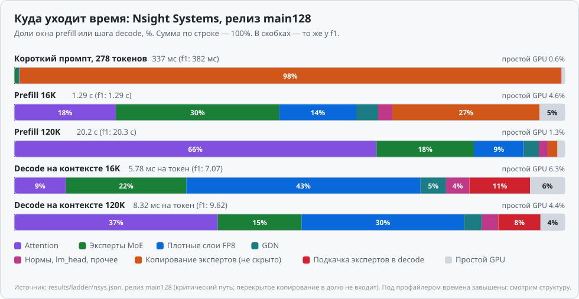
</picture>

**Шаг decode, мс** (на токен):

| Статья шага, мс | f1L0: 16K | **main128: 16K** | f1L0: 120K | **main128: 120K** |
|---|---:|---:|---:|---:|
| Эксперты MoE | 1.60 | **1.26** | 1.60 | **1.27** |
| Плотные FP8 и o-проекция | 2.62 | **2.46** | 2.61 | **2.46** |
| Подкачка промахов (gather) | 1.08 | **0.64** | 1.14 | **0.64** |
| Attention | 0.54 | **0.54** | 3.09 | **3.08** |
| GDN | 0.28 | **0.27** | 0.28 | **0.27** |
| Нормы, lm_head, прочее | 0.34 | **0.24** | 0.35 | **0.25** |
| Копирование, не скрытое | 0.00 | **0.00** | 0.00 | **0.00** |
| Простой графа | 0.59 | **0.36** | 0.54 | **0.37** |
| **Шаг целиком** | **7.07** | **5.78** | **9.62** | **8.32** |

**Prefill, мс на окно:**

| Статья, мс | f1L0: короткий промпт | **main128: короткий** | f1L0: 16K | **main128: 16K** | f1L0: 120K | **main128: 120K** |
|---|---:|---:|---:|---:|---:|---:|
| Эксперты MoE | 74 | **2.6** | 389 | **383** | 3569 | **3566** |
| Плотные FP8 | 0.6 | **0.6** | 196 | **180** | 1847 | **1828** |
| Attention | 0.0 | **0.0** | 233 | **238** | 13278 | **13273** |
| GDN | 0.1 | **0.1** | 67 | **51** | 717 | **552** |
| Копирование экспертов, не скрытое | 302 | **332** | 335 | **345** | 338 | **345** |
| Нормы, прочее | 0.3 | **0.2** | 30 | **33** | 314 | **338** |
| Простой GPU | 4.3 | **2.0** | 44 | **59** | 277 | **270** |
| **Окно prefill целиком** | **382** | **337** | **1294** | **1289** | **20340** | **20171** |
| Копирование по PCIe, ГБ (скрыто за счётом) | 18.2 (31%) | **15.4 (38%)** | 18.2 (86%) | **18.2 (86%)** | 18.3 (86%) | **18.3 (86%)** |

- **Шаг decode на 16K: 7.07 (f1L0) → 5.78 мс.** MoE 1.60 → 1.26 (CUDA-ядро), подкачка промахов 1.08 → 0.64 (больше слотов и перекрытие с общим экспертом), плотные слои и o-проекция 2.62 → 2.46, нормы и прочее 0.34 → 0.24 (слитый эпилог), простои графа 0.59 → 0.36. На 120K шаг 9.62 → 8.32 мс; attention по длинному KV-кэшу (3.08 мс, 37% шага) от рычагов не изменился.
- **Короткий промпт.** Окно prefill 382 (f1L0) → 337 мс, и 98% окна теперь — ожидание копирования экспертов по PCIe (было 79%): вычисление MoE (74 → 2.6 мс на критическом пути) почти полностью спрятано за копией, которую теперь не задерживают ядра инвалидации. Объём копирования упал с 18.2 до 15.4 ГБ (резидентные эксперты копируются внутри GPU).
- **Длинный prefill** почти целиком занят attention: на 120K 13.27 с из 20.17 с (66%). Копирование экспертов скрыто за счётом на 86%. GDN в prefill 120K ускорился 717 → 552 мс.

### Как загружены блоки GPU изнутри (выпуск f1)

**Nsight Compute по модели main128 не снят.** Под ncu сервер не обрабатывает запросы: с CUDA graphs прогрев не завершается (`/health` остаётся `loading`, граф-захват под ncu не заканчивается за 1200 с, юнит упирается в лимит 36 ГиБ), а в eager-режиме сервер поднимается за 1.5 мин, но за 15 мин до модели не доходит ни один запрос (0 батчей в журнале, ни одно ядро не профилировано). Причина не выяснена; диагноз и непроверенные гипотезы — в [`results/ladder/ncu.json`](results/ladder/ncu.json). Поэтому картины ниже — **выпуска f1**: компоненты с теми же формами и конфигурацией запуска, что в f1, посчитанные Nsight Compute (источник — [`results/nsight/ncu-component-kernels.json`](results/nsight/ncu-component-kernels.json)). Ядра декода main128 (o-проекция, MoE GEMV) в Nsight Compute не снимались, для них есть только микробенчи (см. выше).

<picture>
  <source media="(prefers-color-scheme: dark)" srcset="docs/img/gpu-load-dark.svg">
  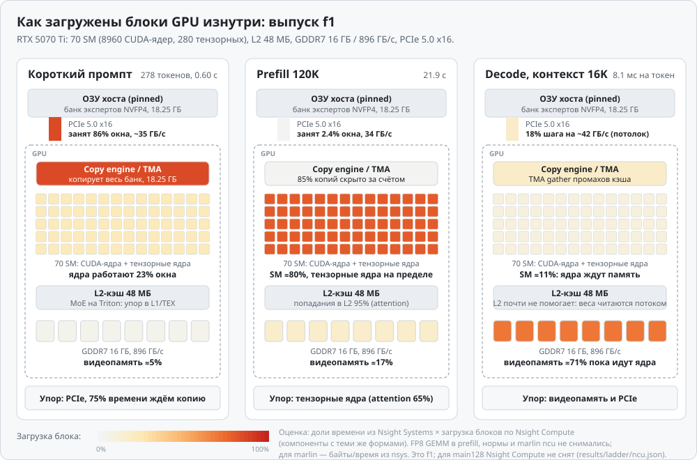
</picture>

- **Короткий промпт.** Нагружен канал PCIe, а SM простаивают: ядра работают лишь 23% окна.
- **Prefill 120K.** Нагружены SM. Ограничитель — тензорные ядра, главный stall `math_pipe_throttle`. PCIe почти свободен, копии скрыты за счётом.
- **Decode.** SM почти без дела. Ядра ждут видеопамять, которая читается на ~90% пика, а промахи кэша экспертов упираются в потолок PCIe.

Подробно по ядрам f1:

<picture>
  <source media="(prefers-color-scheme: dark)" srcset="docs/img/gpu-kernels-dark.svg">
  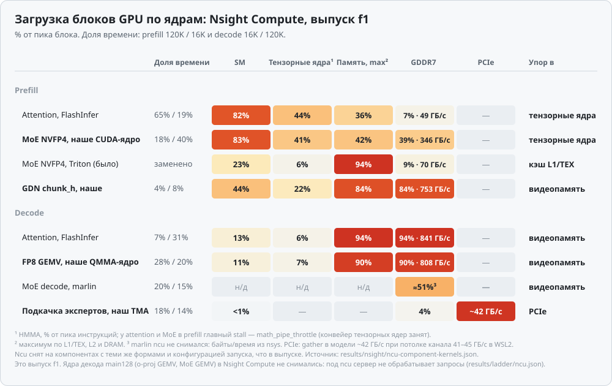
</picture>

Почти все ядра работают у своего аппаратного предела:
- **prefill** упирается в тензорные ядра, а копирование экспертов перекрыто вычислениями на ~85%;
- **decode** упирается в видеопамять и PCIe.

Наше CUDA-ядро MoE в prefill загружает SM на 83%. Исходное Triton-ядро загружало их на 23% и упиралось в кэш L1/TEX.

---

## Память и KV-кэш

**Правило владельца:** ровно 1 ГиБ видеопамяти остаётся Windows (рабочий стол на той же карте), всё остальное отдано модели. Пик памяти процесса обязан укладываться в «вся VRAM − 1 ГиБ» (бюджет 15 279 МиБ = 14.9 ГиБ при карте 15.92 ГиБ); валидатор профилей ограничивает `memory_ratio < 0.95`. Гейты падают не на пороге свободной памяти, а на подкачке (рост разделяемой памяти GPU в Windows больше 256 МиБ) и на замедлении медиан TTFT или декода больше 3%.

**Видеопамять (15.92 ГиБ, профиль main128, медиана в soak):**

| Что | Объём |
|---|---:|
| Кэш экспертов (4603 слота из 10 240, 45%) | 7.64 ГиБ |
| Плотные веса и масштабы (без таблицы эмбеддингов) | 1.57 ГиБ |
| KV-кэш BF16, 131 138 токенов | 2.50 ГиБ |
| Состояния GDN | 0.54 ГиБ |
| Прочее PyTorch | 0.56 ГиБ |
| Контекст CUDA, cuBLAS, рабочий стол Windows (остаток) | ~2.0 ГиБ |
| Свободно (медиана / минимум) | 1.09 / 1.04 ГиБ |

<picture>
  <source media="(prefers-color-scheme: dark)" srcset="docs/img/vram-dark.svg">
  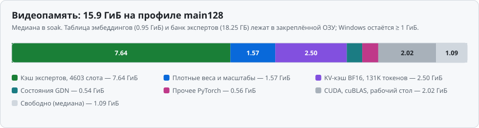
</picture>

Ступени памяти: исходный `memory_ratio` 0.75 давал 3164 слота (f1). Эмбеддинги в RAM хоста освободили 0.95 ГиБ: 3729 слотов при том же коэффициенте. Коэффициент 0.85 довёл их до 4611; ядра декода оставили 4603 (см. [«Найденные ошибки»](#найденные-ошибки-и-подводные-камни)). Ступень 0.85 выбрана по пробному soak: на 0.90 декод и TTFT были хуже из-за давления памяти (цифры того soak в репозиторий не входят). Свободные ~1.1 ГиБ — не лишние: это запас Windows и временные буферы. Пул KV-кэша выделяется один раз при старте и дальше не растёт.

**Пик процесса:** 13 835 МиБ в лесенке (максимум по ступеням), 13.4 ГиБ в релизном A/B при бюджете 14.9 ГиБ. Подкачки Windows нет: разделяемая память GPU за 2 часа soak выросла на 30 МиБ.

**Оперативная память (soak main128, медиана):**

| Что | main128 | f1 |
|---|---:|---:|
| Сервис целиком (cgroup) | 20.9 ГиБ | 19.9 ГиБ |
| Анонимная память (в ней закреплённый банк экспертов 17.0 ГиБ) | 19.8 ГиБ | 19.7 ГиБ |
| Разделяемая память (таблица эмбеддингов 0.95 ГиБ) | 1.06 ГиБ | 0.11 ГиБ |
| Рост анонимной памяти за 2 ч | +58…62 МБ | +45…48 МБ |
| Свободно в WSL (MemAvailable, медиана) | 24.4 ГиБ | 25.0 ГиБ |
| Пик при запуске | 28.7 ГиБ | 27.8 ГиБ |

Порог гейта на рост анонимной памяти — 268 МБ, на рост разделяемой — 67 МБ (она не выросла).

**KV-кэш:**
- 20 480 байт на токен в BF16 (10 слоёв полного attention);
- пул main128 — 131 138 токенов (2.5 ГиБ), long256 — 262 175 (5.0 ГиБ); в soak использовано не больше 120 267 страниц (91.7% пула);
- кэш префиксов: в soak 110/110 попаданий, 91.6% токенов из кэша; продолжение диалога на 4K отвечает за 0.25 с (матрица 16.10) вместо 2.20 с у исходного FreeToken.

---

## Гарантия качества

- **Побитовый teacher-forcing.** Релиз main128 и эталон `bf128` получают одни и те же 20 фиксированных кейсов: русский, код, JSON, длинные документы 4K–120K, всего 943 принудительных целевых токена. Во всех **125/125** контрольных точках логиты одинаковы: max |Δlogit| = 0, max относительная L2 = 0, все логиты побайтно равны. Рост перплексии **+0.0%** (ДИ [0, 0]), новых функциональных провалов нет (два известных провала, `executable-code` и `long-facts-16384`, одинаковы в эталоне и в выпуске).
- **Каждая ступень лесенки бит-точна.** Все 13 конфигураций (f1L0, девять ступеней релиза, две отвергнутые ступени и вариант «f1 плюс только shared-эксперт параллельно с подкачкой») прошли teacher-гейт 125/125, `max_abs` 0. Эталон — свежий teacher-bf128, побайтно совпавший с закреплённым `logit-reference`. Оговорка: teacher первых ступеней снят на более раннем рантайме, чем остальные; в промежутке код параллельного shared-эксперта был переложен, поэтому квитанции ступеней от «shared-эксперт параллельно с подкачкой» до «копирование без ожидания GEMM» включительно относятся к прежнему коду этого рычага. Более поздние ступени и сам релиз проверены на текущем дереве.
- **Профиль 256K на новом дереве** даёт ровно 125/125 побитово (кейс 120K идёт на чистом кэше префиксов, харнесс v7). У f1 в стандартном порядке кейсов было 121/125 с эквивалентностью `PASS_EQUIV`, и ровно 125/125 только на чистом кэше: причина — свойство кэша префиксов (подмена KV общего заголовка чата), а не наши изменения; это доказано на GPU с двух сторон.
- **Контент ответов.** В релизном A/B f1L0 ↔ main128 тексты ответов совпали в 40 из 40 случаев (жадная генерация).
- **Компонентные тесты ядер.** o-проекция: 832 случая × 6 вариантов, 0 расхождений; MoE decode: 4284 сравнения, 0 расхождений; слитый эпилог: сигмоида сверяется на всех 65 536 значениях bf16 при старте процесса. Рычаги, переставляющие копии между потоками, держатся на явном объединении по событию: негативный контроль без него давал 14 248 расхождений контрольных сумм.
- **FP32-масштабы.** Эталон хранит глобальные масштабы NVFP4 (`weight_scale_2`) в FP32. Исходный FreeToken приводит их к FP16, и 94% из них становятся субнормальными числами. Это исправление меняет вычисления намеренно. Перплексия лучше на 1.13% (ДИ [−2.27%, −0.08%]), заранее зарегистрированный eval из 60 кейсов: 59/60 против 57/60.
- **Границы гарантии.** Побитовая точность доказана на фиксированных кейсах, это не доказательство для любых входов. Подробно в [docs/METHODOLOGY.md](docs/METHODOLOGY.md).

Путь каждого изменения до выпуска. Провал на любом шаге возвращает изменение в работу:

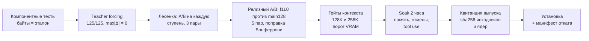

---

## Стабильность и эксплуатация

| Проверка | Результат |
|---|---|
| Релизные гейты main128 (происхождение и CPU-проверки, teacher, контекст 128K, релизный A/B, soak 2 ч) | все PASS |
| Soak 2 часа, main128 | 800/800 проверок, 891 запрос, 0 ошибок, 0 зависаний, рост памяти хоста +58…62 МБ (порог 268 МБ) |
| Контекст 128K | граница 131 072 токена проходит точно, +1 токен — 400 `context_length_exceeded`; отмена и бэкенд — PASS |
| `long256` на новом дереве | teacher ровно 125/125; контекстные гейты 250K и граница 262 144 — PASS |
| Отмена запроса | в soak готов к следующему через 0.47 с (макс 0.48); у f1 было 1.45 с. На 250K посреди prefill (f1, 30-минутный тест) — 1.64 с |
| Тест 30 минут, `long256` (f1) | 109/109 кейсов, 11 промптов по 250K, 6 отмен посреди prefill |
| Гонка освобождения страниц в кэше (f1) | проверена: заливка освобождённых страниц NaN даёт побитово тот же вывод, контроль без синхронизации ловит ошибку |
| Холодный старт / перезапуск (f1) | 132 с / 125 с до готовности через edge; для main128 не переснимались |
| Сетевые проверки через reverse proxy (f1) | 59/60 (единственный провал — почти-ничья модели, см. ограничения); для main128 не переснимались |
| Цикл tool use (f1, 160 прогонов) | контракт API 100%: 228/228 аргументов — валидный JSON; итоговый ответ верный в **97.5%**. В soak main128: 33 цикла из 33 пройдены |

**Установка и откат.** Одна процедура [`harness/release-main128.sh`](harness/release-main128.sh): `--dry-run` → `--check` → `--apply` (только с разрешения владельца; сервис при `--apply` остановлен). Перед установкой делается полный снимок f1. **Откат на f1** (метка установки `main128-s5r1`):

```bash
bash harness/release-main128.sh --rollback --check --label main128-s5r1
bash harness/release-main128.sh --rollback --apply --label main128-s5r1
```

Шаги, проверка после старта и что смотреть в логе — в [`harness/OPERATIONS.md`](harness/OPERATIONS.md#main128-next-релиз-и-откат). После запуска в логе должны быть две строки самопроверки ядер: `QWEN36_OPROJ_GEMV enabled: ... bit-exact self-test passed for M [1, …, 8]` и `QWEN36_MOE_DECODE_CUDA enabled: ... bit-exact self-test passed for M [...]`. Тревога — любая строка с `disabled` или `mismatch`: точность сохраняется (эти M остаются на cuBLASLt/Triton), но выигрыш релиза пропадает.

---

## Найденные ошибки и подводные камни

**Цикл f1:**

| Что нашли | Последствие | Что сделали |
|---|---|---|
| FreeToken хранит глобальные масштабы NVFP4 в FP16 | 94% масштабов субнормальные, точность хуже | перевели на FP32; черновик issue в `docs/upstream-notes/` |
| `cp.async.bulk.shared::cluster` на sm_120 компилируется в **системный вызов драйвера** | каждый запуск такого ядра навсегда забирает **1.37 ГиБ VRAM** под стек | переписали на `.shared::cta`: те же байты, 0 МиБ |
| `MADV_HUGEPAGE` на разделяемой памяти в WSL не работал | huge pages не включались | `MAP_PRIVATE` |
| Анонимная память glibc росла | +394 МБ за 2 часа | `GLIBC_TUNABLES` |
| Кэш префиксов подменяет KV общего заголовка чата копией из прошлых запросов | на почти-ничьих при temperature 0 ответ зависит от истории кэша | это штатное поведение, как у SGLang и vLLM; тест эталона гоняет кейс 120K на чистом кэше |
| RMSNorm (1+w) округляется в bf16 при загрузке | отклонение ~0.1% от transformers | задокументировано; эффект в пределах шума |
| Потолок PCIe в WSL2 | gather decode упирается в 41–45 ГБ/с из ~63 теоретических (copy engine в prefill после перестройки очереди выходит на ~48 ГБ/с) | gather уже у потолка; дальше только перекрывать копирование с вычислениями |

**Цикл main128:**

| Что нашли | Последствие | Что сделали |
|---|---|---|
| **Гонка в пробе batch-memcpy FreeToken** (`freetoken/python/freetoken/kernel/batch_memcpy.py`, `_probe`): проба заполняла приёмник нулями на текущем потоке, а копировала на новом неблокирующем без упорядочивания | если копия успевала раньше заполнения, проба ложно сообщала «wrong bytes», и рычаг «короткий маршрут prefill» отключался на весь процесс без видимой ошибки | одна строка: `stream.wait_stream(torch.cuda.current_stream())` перед копией; тест с занятым matmul'ами потоком (50 проб) — старая проба падает детерминированно, исправленная проходит |
| **Triton по умолчанию сливает `mul` + `add` в `fma.rn.bf16`** (fp-contract) | одно округление вместо двух: теряется побитовая совпадаемость с torch, при этом результат «выглядит» верным | ядра эпилога запускаются с `enable_fp_fusion=False`; проверка по PTX без GPU (в PTX остаются отдельные `mul.rn.bf16` и `add.rn.bf16`, негативный контроль с fusion ловит `fma.rn.bf16`) |
| **cuBLASLt split-K = 3 для o-проекции** делит K не на непрерывные куски: K режется на 64-байтные тайлы, тайлы раздаются сплитам по кругу, части суммируются как (p0 + p2) + p1 | гипотеза «непрерывные диапазоны» не сходилась на 1–7 элементах; ядро `splitKreduce` в трассе, которое считали частью o-проекции, на деле шло после GEMV роутера | порядок установлен пробами поглощения и SASS и повторён побитово в нашем ядре (832 случая, 0 расхождений) |
| **Самопроверки ядер при финализации весов** оставляют scratch (≈14 МиБ) в кэше аллокатора PyTorch | бюджет памяти засчитывает его как веса: на 8 слотов меньше (4603 вместо 4611) | оставлено как есть; `empty_cache` после самотестов — в планах |
| **Наш харнесс**: `compare-ab` не отбрасывал строки `warmup_sustained` | первый релизный A/B ложно получил вердикт INVALID | исправлено, A/B повторён, учтён только повтор |
| **Наш харнесс**: `extract-run` выдаёт квитанцию только основного запуска | квитанция описывает только основной запуск, квитанцию чистого повторного запуска выдать нельзя | нужна опция `--clean-run` (в планах) |
| **Nsight Compute не профилирует модель**: под ncu сервер не обрабатывает запросы | нет ncu-профиля ядер main128 | диагноз в `results/ladder/ncu.json`; профиль ядер — через компонентные бенчи |
| **Ядра инвалидации перед копией каждого слоя** стояли в очереди за блоками MoE-GEMM (6 ядер на слой, 240 на prefill) | копирование простаивало 55–60 мс на prefill (разрывы между пачками ~1.4 мс на слой) | поток копирования с высшим приоритетом и одна инвалидация на эпоху: копия идёт сплошным потоком (в Nsight окно prefill 907 → 429 мс) |
| **Предвыборка экспертов на слой вперёд не пряталась** в первом микробенче: копия равнялась по времени последовательной | рычаг не давал выигрыша | причина — порядок раздачи блоков: цепочка побочного потока ждёт SM за большим ядром миксера; приоритет побочного потока это снимает (микробенч: −21…−41% шага цикла); на модели ещё не проверено |

---

## Профили

| Профиль | Контекст | Слотов экспертов | Назначение |
|---|---:|---:|---|
| `main128` (по умолчанию) | 131 072 | 4603 | повседневная работа: f1 плюс девять рычагов main128 |
| `long256` | 262 144 | 1481 | длинные документы: без рычагов main128, больше KV и меньше слотов, поэтому decode медленнее: на 120K 89.0 ток/с против 121.0 у main128 (разные сессии), на 250K 67.3. С рычагами main128 на 250K: 76.0 ток/с (статистика без teacher, в профиль не включено) |
| `baseline64` | 65 536 | 3917 | неизменный запасной вариант (исходная механика с FP32-масштабами) |

---

## Железо и софт

| Что | Значение |
|---|---|
| GPU | NVIDIA RTX 5070 Ti 16 ГБ (SM120, Blackwell, 70 SM, ~896 ГБ/с), PCIe 5.0 x16. Она же выводит рабочий стол Windows (4K, 159 Гц), которому оставлен 1 ГиБ VRAM |
| CPU / RAM | Intel Core i7-14700KF; виртуальной машине WSL2 видно ~47 ГиБ, сервис ограничен MemoryHigh 32 ГиБ |
| ОС | Windows 11 + WSL2 (WSL 2.7.3, Arch Linux, ядро 6.6, systemd 262); драйвер NVIDIA 617.14 |
| CUDA | 13.4 (toolkit 13.4.1, nvcc 13.4.59), GCC 15.3 |
| Python | 3.12.14; torch 2.11.0 (cu130), Triton 3.6.0, FlashInfer 0.6.18.post1, sglang-kernel 0.4.5, transformers 5.16.1 |
| Движок | FreeToken 0.1.3 (`cac247a860e316e06580d05aeb05f2e647bde214`) + изменения в `freetoken/` |
| Чекпойнт | `nvidia/Qwen3.6-35B-A3B-NVFP4` @ `1355db6a052410cfd62085d94b58866fd0f2c3c5`: эксперты NVFP4, плотные слои FP8, отдельные слои BF16 |

---

## Структура репозитория

```text
qwen36-moe-16gb/
├── freetoken/        доработанный движок FreeToken (Apache-2.0); все изменения — в MODIFICATIONS.md
├── kernels/          исходники побитово точных CUDA-библиотек, сборка и тесты
│   ├── nvfp4-moe/      MoE prefill на NVFP4
│   ├── gdn/            Gated DeltaNet + слитые ядра FLA
│   ├── fp8-gemv/       FP8 GEMV на QMMA для decode
│   ├── attention-gate/ слитый gate для attention
│   ├── decode-oproj/   o-проекция decode: копия cuBLASLt split-K (main128)
│   └── decode-moe/     MoE decode GEMV вместо Triton (main128)
├── serving/          guard API, валидатор профилей, скрипты сервиса и запуска
├── harness/          квалификация и бенчмарки: teacher-forcing, матрица, A/B, soak, гейты, релиз и откат
├── config/           профили; local.env.example — шаблон локальных настроек
├── docs/             архитектура, результаты, методика, план, заметки для upstream; img/ — графики README
├── results/          доказательства: дашборд f1, метрики, Nsight, JSON матрицы, лесенки рычагов (ladder/), soak и гейтов
├── next-update/      материалы разработки рычагов: патчи, скрипты замеров, сырые результаты
├── tools/            сканер секретов, генераторы графиков (readme_charts.py, ladder-charts.py, model-diagram.py)
└── local/            данные конкретной машины (в .gitignore, не публикуется)
```

TMA gather для decode — JIT-модуль внутри `freetoken/` (`freetoken/python/freetoken/kernel/csrc/jit/decode_gather.cuh`).

Графики README генерирует `python tools/readme_charts.py`: цифры матрицы и лесенки читаются из `results/matrix/`, `results/ladder/`, Nsight — из `results/ladder/nsys.json`. Дашборд выпуска f1: `results/dashboard/qwen36-release-f1.html` (скачать и открыть в браузере).

---

## Быстрый старт

> Проект рассчитан на конкретную конфигурацию: Linux (WSL2), чекпойнт на локальном диске и GPU SM120 с 16 ГБ. Установки одной командой нет.

1. **Окружение.** Создайте venv с Python 3.12 и стеком из таблицы выше. Установите `freetoken/` из исходников: инструкции upstream в `freetoken/README.md`, затем `freetoken/MODIFICATIONS.md`.
2. **Локальные настройки.** Скопируйте `config/local.env.example` в `config/local.env` и укажите пути к чекпойнту, venv, CUDA и каталогу сервиса. Файл `local.env` в `.gitignore`.
3. **Ядра.** Соберите библиотеки из `kernels/` под `sm_120a`: в каждой папке `build.sh` и тесты на побитовую точность, подробности в `kernels/README.md`. Для main128 нужны ещё две библиотеки: `kernels/decode-oproj` (`libqwen_oproj_gemv.so`) и `kernels/decode-moe` (`libqwen_moe_decode.so`). Движок подгружает библиотеки по путям, закреплённым через sha256. С `FREETOKEN_DISABLE_JIT=1` он использует только prebuilt-ядра из манифеста и никогда не компилирует во время работы.
4. **Запуск.** Выберите профиль в `config/` и запустите его через скрипт из `serving/`. Валидатор профилей откажет в неквалифицированных или противоречивых сочетаниях переключателей.
5. **Проверка своей сборки.** Прогоните харнесс из `harness/`:
   - `qualify.py` — teacher-forcing против своего эталона;
   - `matrix.py` + `compare-ab.py` — парная матрица скорости;
   - `soak.py` — длительная нагрузка.

   Порядок и критерии описаны в [docs/METHODOLOGY.md](docs/METHODOLOGY.md).
6. **Релиз и откат.** `harness/release-main128.sh` (см. [«Стабильность и эксплуатация»](#стабильность-и-эксплуатация)).

API совместим с OpenAI chat completions: стриминг, автоматический вызов инструментов (`tool_choice: auto/none`), параллельные вызовы.

---

## Ограничения

- **Один запрос за раз** (batch 1, без очереди; занятый сервер отвечает 429). Параллельная нагрузка не замерялась.
- **Только текст.** Vision и MTP / спекулятивный декодинг не загружаются.
- **Нет ограниченного декодинга.** `tool_choice` со значением required или с именем функции, `strict: true`, `parallel_tool_calls=false` вместе с инструментами и устаревшие `functions` отклоняются с кодом 400.
- **Нижняя граница TTFT.** Свежий промпт от ~2K токенов стоит не меньше ~0.38 с: prefill прокачивает по PCIe весь банк экспертов (18.25 ГБ при ~48 ГБ/с). Короткие промпты вывозят только нужных экспертов: промпт из 64 токенов — 0.20 с.
- **Длинный свежий prefill не ускорился** относительно f1 (120K: 20.4 с против 20.5 с): он упирается в тензорные ядра attention, ядро которого работает у аппаратного предела (Nsight Compute, выпуск f1).
- **Почти-ничьи самой модели.**
  - Два фиксированных функциональных кейса проваливаются при жадном декодинге одинаково в эталоне и в выпуске.
  - Без thinking модель иногда отвечает сама вместо вызова инструмента, а в 6 из 10 запросов к справочнику придумала значение.
  - **Для работы с инструментами включайте thinking.**
- **Запас видеопамяти — это то, что оставлено Windows.** По правилу владельца карте оставлен ровно 1 ГиБ: в soak свободно минимум 1.04 ГиБ. Если рабочий стол займёт больше обычного, запас сократится; гейты следят за подкачкой и замедлением, а не за порогом свободной памяти.
- **WSL2.** Один copy engine, WDDM делит время GPU с рабочим столом (шум в замерах), канал хост → GPU упирается в 41–45 ГБ/с для gather.
- **256K без полного soak.** Пройден 30-минутный тест стабильности (f1) и контекстные гейты на новом дереве; рычаги main128 на 256K мерились как статистика без teacher и в профиль `long256` не включены.
- **Nsight Compute по модели main128 не снят** (см. [раздел про профиль](#куда-уходит-время-профиль-nsight)).
- **Цифры «против исходного» приведены цепочкой**, а не прямым замером (см. [«Главные результаты»](#главные-результаты)).

---

## Что дальше

Ранее принятые решения — в [docs/ROADMAP.md](docs/ROADMAP.md) (часть пунктов там уже выполнена в main128).

1. **Предвыборка экспертов на слой вперёд с приоритетным потоком** (`QWEN36_DECODE_PREGATE_PRIORITY=1`, по умолчанию выключен). На микробенче прячет 44–92% копии, шаг цикла −21…−41% при одноядерном миксере и −17…−32% при шестиядерном (как в GDN); это верхняя оценка, потому что в бенче нет роутера, GEMM экспертов и attention. Нужны модельный A/B и teacher-гейт.
2. **Nsight Compute через компонентные бенчи** для ядер декода main128 (o-проекция, MoE GEMV, gather, копирование): профиль модели под ncu снять не удалось.
3. **`empty_cache` после самопроверок ядер:** вернёт 8 слотов (4603 → 4611).
4. **Опция `--clean-run` для `extract-run`:** квитанция чистого повторного запуска.
5. **Рычаги main128 для `long256`:** на 250K декод +13% (76.0 против 67.3 ток/с); нужны teacher-гейт и 2-часовой soak на 256K.
6. **Клиентский map-reduce для документов длиннее ~100K токенов:** документ делится на части, части обрабатываются независимо, результаты сводятся. Это приём на стороне клиента, не изменение сервера; стоимость prefill растёт быстрее длины (20.4 с на 120K против 72.3 с на 250K).
7. **FlashPrefill** (ускорение prefill на очень длинных промптах за счёт разреженного attention) — не входит в этот план: метод меняет вычисления, и побитовая точность не гарантируется. Только отдельным решением владельца и отдельным профилем.
8. **Переход на новый стек** (torch 2.14, Triton 3.8): сначала анализ, что изменится в повторяемых нами ядрах.

---

## FAQ

**Зачем побитовая точность, если можно «почти так же»?**
Это единственная проверка, которая не требует доверять статистике. Если логиты совпадают побитово, качество модели гарантированно не изменилось, и любое ускорение можно выпускать без долгих eval-прогонов.

**Откуда цифры «против исходного FreeToken», если его не мерили заново?**
Из цепочки: старая матрица (13–14.10) даёт f1 и исходный FreeToken в одной сессии, две матрицы подряд 16.10 (3 пары каждая, одна сессия) дают f1 и main128. Отношение main128/f1 (медиана main128 из второй матрицы на медиану f1 из первой) переносится на f1 из старой матрицы; в цепочке участвуют только отношения внутри сессий. Это честно, пока отношение не зависит от состояния системы. Для коротких промптов зависит заметно: f1 в сессии 16.10 на 64-токенном промпте в 1.9 раза быстрее, чем в старой матрице (0.41 против 0.79 с), поэтому приведённое значение main128 (0.39 с) консервативно, а прямой замер main128 на 64 токенах — 0.200 с. Отдельно от цепочки релиз подтверждён парным A/B на 5 пар против f1L0 (настройки f1 на новом коде).

**Чем f1 отличается от f1L0?**
f1 — прошлый выпуск, установленный рантайм. f1L0 — те же настройки f1 (профиль `main-release`) на новом коде дерева main128 без рычагов. На 120K: f1 — TTFT 20.54 с, декод 102.8 ток/с; f1L0 — 20.52 с, 103.5 ток/с. На коротких запросах f1L0 быстрее на 4–7% по TTFT и на 0.5–2.7% по декоду (3 пары, контроль даёт сопоставимый разброс), так что общие правки кода дают немного, а основной выигрыш — от рычагов.

**Почему TTFT на длинных промптах почти не изменился против f1?**
В длинном свежем prefill копирование экспертов уже на 86% скрыто за счётом, а сам счёт упирается в тензорные ядра attention (66% окна на 120K). Рычаги main128 бьют по decode (+17…+31%), по коротким запросам и по правкам диалога (там TTFT в 1.4–2.8 раза меньше); длинный prefill остаётся прежним (×1.01 на 120K).

**Почему `memory_ratio` 0.85, а не больше?**
Правило владельца: Windows остаётся ровно 1 ГиБ. На 0.85 пик процесса 13.4 ГиБ при бюджете 14.9 ГиБ, свободно ≥ 1.04 ГиБ, подкачки нет. На 0.90 в пробном soak декод и TTFT были хуже из-за давления памяти.

**Почему не FP8 KV-кэш, ведь decode быстрее на 26–46%?**
Свежие длинные промпты становятся медленнее на 26–33% (prefill-attention в FlashInfer с FP8 KV на этой карте медленный), и пропадает побитовая точность. Выигрыш есть только в длинных диалогах с кэшем и длинными ответами. Конфиг и план проверки готовы, если понадобится. Цифры замерены на f1.

**Можно ли выжать больше из PCIe?**
Для подкачки промахов в decode — не на этой системе. Замер потолка: copy engine 40.8 ГБ/с, TMA 43.4 ГБ/с, а больше параллельных запросов скорость только снижает; gather уже работает на ~42 ГБ/с. В prefill после перестройки очереди копирования (копирование без ожидания GEMM) банк идёт на ~48 ГБ/с (18.25 ГБ за ~0.38 с по Nsight), то есть там копия идёт сплошным потоком. На нативном Linux могло бы быть больше, это не проверялось. Скорость шины в WSL2 заметно плавает от запуска к запуску (в одном из замеров 29–40 ГБ/с на одном и том же коде).

**Подойдёт ли это для другой модели?**
- Для моделей семейства Qwen3.5/3.6 MoE в NVFP4 большая часть заработает после подстройки под формы матриц и заново проверенного teacher-forcing.
- Другая MoE-архитектура потребует новых ядер.
- Модели, которые целиком влезают в VRAM, выгрузка экспертов не нужна.

---

## Благодарности и лицензия

- **[FreeToken](https://github.com/FlashML-org/FreeToken)** (FlashML-org, Apache-2.0) — движок, который дорабатывает эта работа. Копирайт и лицензия upstream сохранены в `freetoken/LICENSE`, изменения перечислены в `freetoken/MODIFICATIONS.md`.
- Чекпойнт **`nvidia/Qwen3.6-35B-A3B-NVFP4`** опубликован NVIDIA и квантован из Qwen3.6-35B-A3B, модели **команды Qwen**. Веса сюда не входят и распространяются под своей лицензией.
- Работа опирается на **FlashInfer, Triton, flash-linear-attention, sglang-kernel и PyTorch**.
- Код этого репозитория распространяется под **Apache-2.0**, см. `LICENSE` и `NOTICE`.
