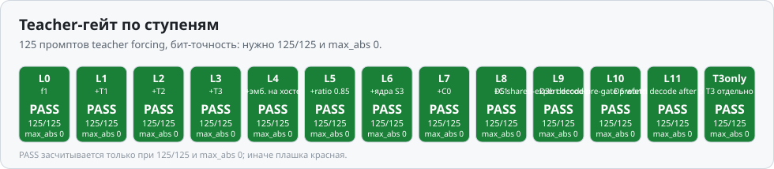
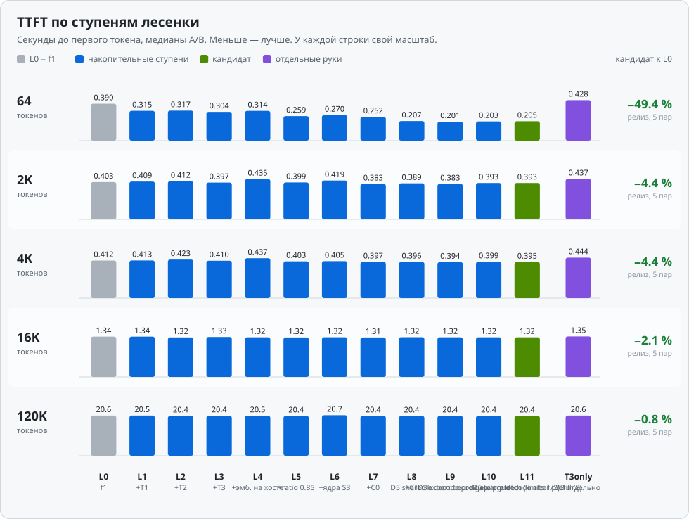
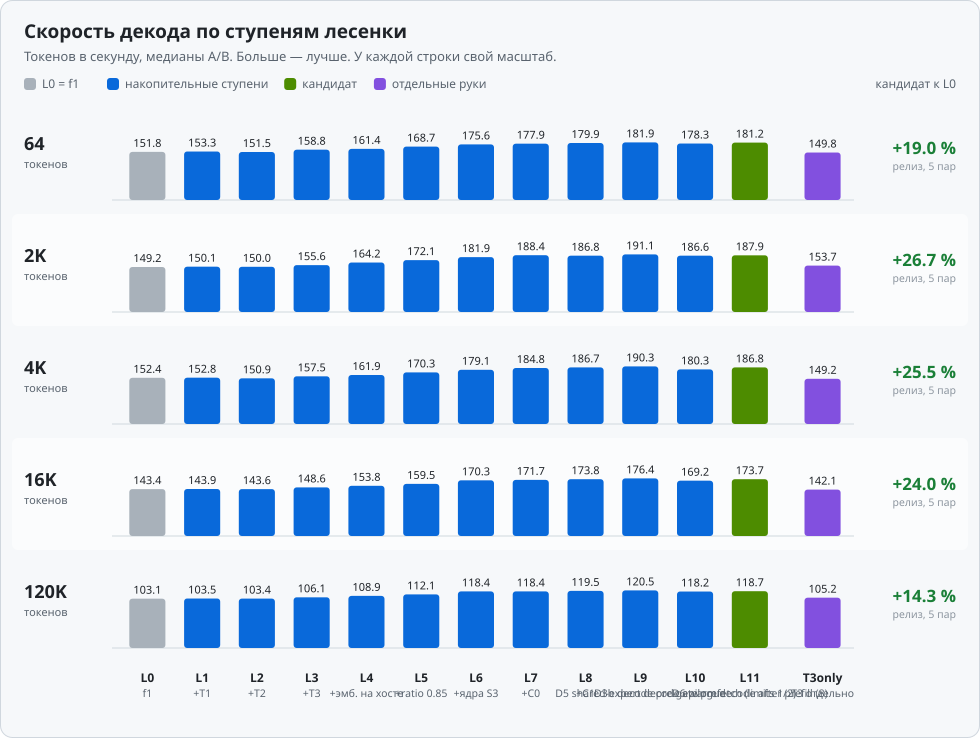
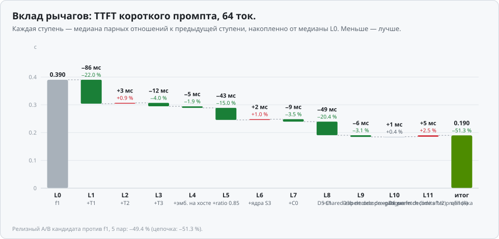
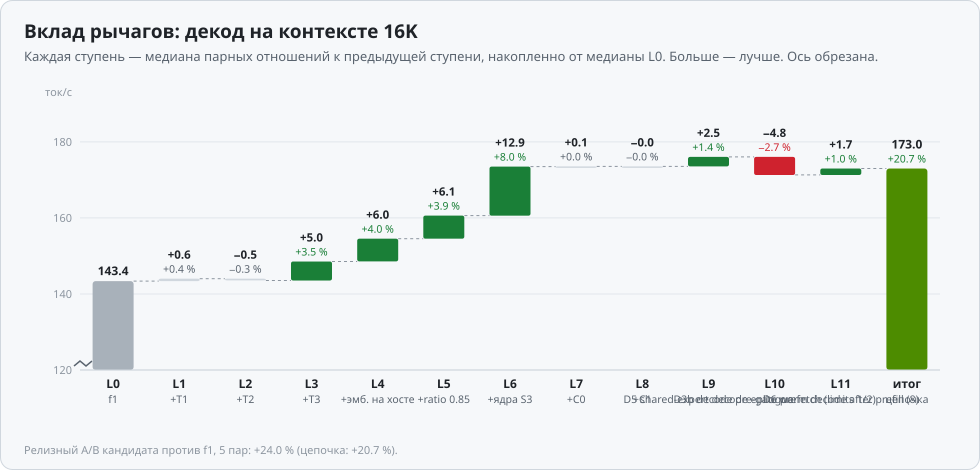
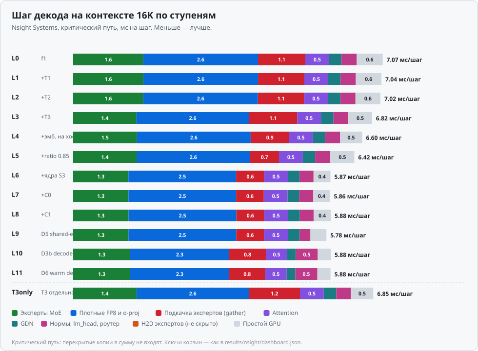
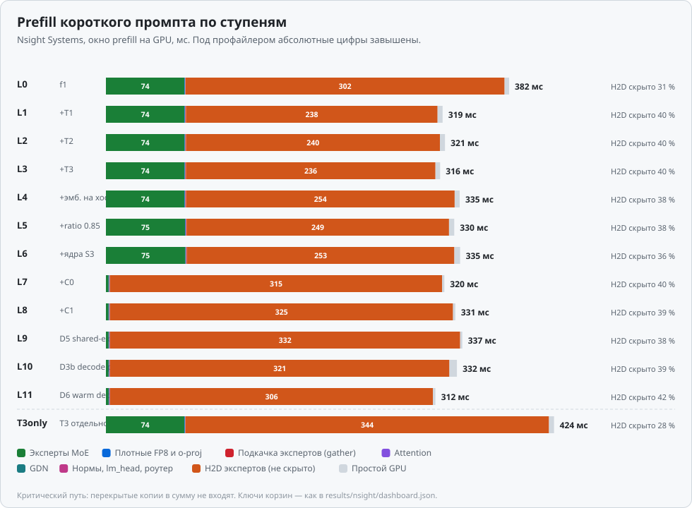
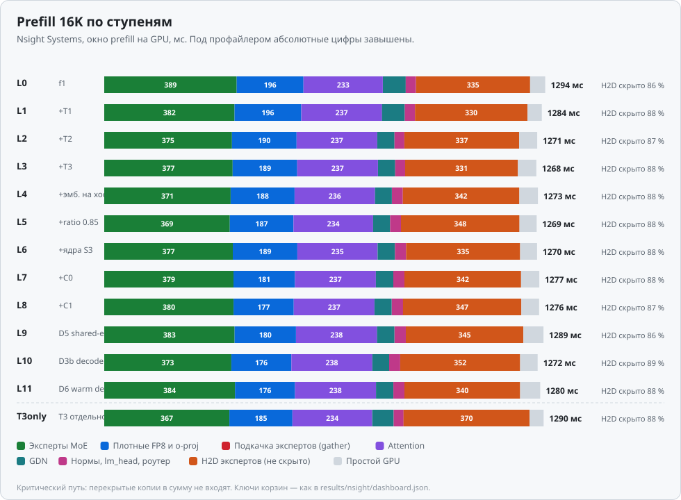
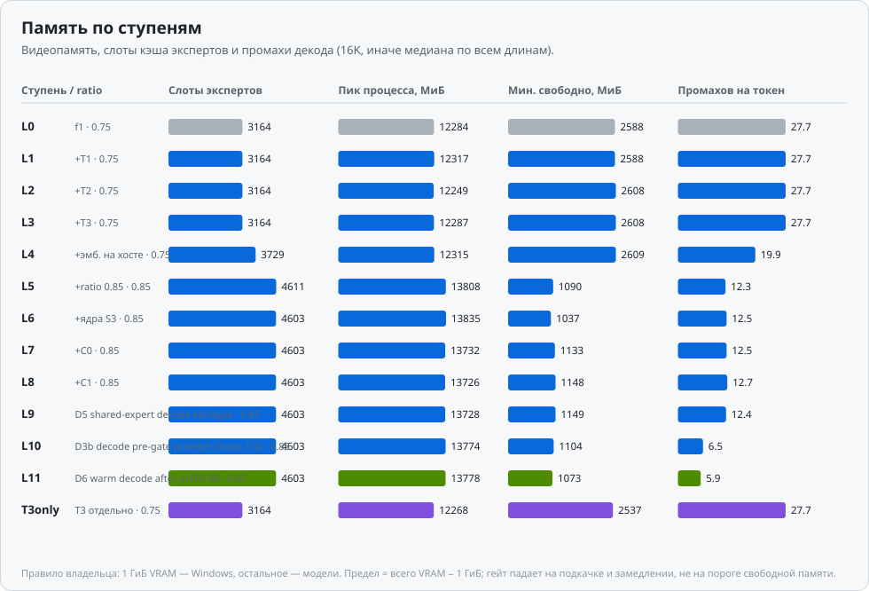

# Выпуск main128: накопительная лесенка (черновик)

[English](RELEASE-MAIN128.en.md)

> **Черновик.** Цифр лесенки пока нет: прогоны на GPU идут. Таблицы ниже — места под цифры.
> Графики в `results/ladder/charts/` появятся после прогонов. Черновые графики в
> `results/ladder/charts-draft/` нарисованы по синтетической фикстуре и результатом не являются.

## Что вошло

Профиль main128 (контекст 131072 токена). Каждая ступень добавляет к предыдущей один рычаг. Все рычаги
выключены по умолчанию и включаются флагами конфигурации.

| Ступень | Рычаг | Что делает | Конфиг / флаги |
|---|---|---|---|
| L0 | main-release (f1) | выпуск f1, точка отсчёта | `harness/main-release.json` |
| L1 | +T1 | hit-D2D: эксперты, уже лежащие в VRAM, копируются внутри GPU; layer-major prefill от 2049 токенов | `harness/main-release-shortroute.json` |
| L2 | +T2 | слитое CUDA-ядро GDN (FLA `wu`) в prefill | `harness/main-release-shortroute-fla-wu.json` |
| L3 | +T3 | декод: подкачка экспертов перекрывается с общим экспертом того же слоя | `harness/main-release-shortroute-fla-wu-overlap.json` |
| L4 | +эмбеддинги на хосте | таблица эмбеддингов BF16 (0,95 ГиБ) в закреплённой памяти хоста; освободившаяся VRAM уходит под слоты экспертов | `QWEN36_HOST_EMBEDDINGS=1`, `harness/main-release-next-he.json` |
| L5 | +memory_ratio 0,85 | больше слотов кэша экспертов | `harness/main-release-next-he-r085.json` |
| L6 | +ядра S3 | CUDA-ядра декода: o-proj GEMV и MoE GEMV вместо cuBLAS/Triton, бит-в-бит | `QWEN36_OPROJ_GEMV=1`, `QWEN36_MOE_DECODE_CUDA=1` |
| L7 | +C0 | приоритет копирующего потока и инвалидация буферов один раз на эпоху prefill | `QWEN36_PREFILL_COPY_PRIORITY=1`, `QWEN36_PREFILL_EPOCH_INVALIDATE=1` |
| L8 | +C1 = кандидат | в короткий prefill копируются только выбранные роутером эксперты | `QWEN36_PREFILL_SELECTED=160` |
| T3 отдельно | f1 + T3 | T3 без остальных рычагов, отдельная рука | `harness/main-release-overlap.json` |

Конфиги L6–L8 указываются в `results/ladder/summary.json` по факту прогонов.

## Как мерили

- **Teacher-гейт на каждой ступени.** 20 случаев, 943 токена teacher forcing, 125 контрольных точек
  логитов. Сравнение с эталоном побитовое: нужно 125/125 и `max_abs` 0. Ступень без PASS в кандидата
  не идёт.
- **A/B на каждой ступени: 3 пары.** Ступень против предыдущей в той же сессии, порядок рук чередуется
  по раундам. На каждую длину промпта (64 / 2K / 4K / 16K / 120K) берутся сырые значения по парам.
  Вклад ступени — медиана отношений «ступень / предыдущая» внутри пары. Так дрейф шины между запусками
  сервера (у S4 H2D менялся от 29 до 40 ГБ/с) не попадает в оценку.
- **Релизный A/B: 5 пар.** Кандидат L8 против f1, `harness/compare-ab.py`: геометрическое среднее
  5 парных отношений с односторонними границами Стьюдента 97,5 %. Гейтит elapsed, TTFT и декод
  показываются как наблюдения.
- **Soak.** Гейт относительный, к soak f1. Он падает на росте разделяемой памяти GPU в Windows
  больше чем на 256 МиБ (подкачка) и на ухудшении медиан TTFT или декода больше чем на 3 %. Свободная VRAM только
  показывается в отчёте.
- **Nsight Systems на каждой ступени.** Критический путь шага декода на 16K, prefill короткого промпта
  и prefill 16K. Корзины те же, что в `results/nsight/dashboard.json`: эксперты MoE, плотные FP8 и
  o-proj, gather, attention, GDN, нормы/lm_head/роутер, не скрытое H2D, простой GPU. Под профайлером
  абсолютные времена завышены, поэтому по nsys смотрим только структуру.

### Правило VRAM владельца

1 ГиБ видеопамяти остаётся Windows, всё остальное отдаётся модели. Пик процесса (максимум занятой
памяти минус занятая до старта) должен укладываться в «всего VRAM − 1 ГиБ». Гейты падают на подкачке
(рост разделяемой памяти GPU) и на замедлении, а не на пороге свободной памяти. Свободная VRAM
показывается для сведения.

## Ступени

Цифры — медианы A/B. В скобках — вклад ступени к предыдущей (медиана парных отношений). Таблицы
генерирует `tools/ladder-charts.py` в `results/ladder/charts/ladder-table.md`; сюда они переносятся
после прогонов.

### TTFT, с

| Ступень | 64 | 2K | 4K | 16K | 120K |
|---|---|---|---|---|---|
| L0 f1 | … | … | … | … | … |
| L1 +T1 | … | … | … | … | … |
| L2 +T2 | … | … | … | … | … |
| L3 +T3 | … | … | … | … | … |
| L4 +эмбеддинги на хосте | … | … | … | … | … |
| L5 +memory_ratio 0,85 | … | … | … | … | … |
| L6 +ядра S3 | … | … | … | … | … |
| L7 +C0 | … | … | … | … | … |
| L8 +C1, кандидат | … | … | … | … | … |
| T3 отдельно | … | … | … | … | … |

### Декод, ток/с

| Ступень | 64 | 2K | 4K | 16K | 120K |
|---|---|---|---|---|---|
| L0 f1 | … | … | … | … | … |
| L1 +T1 | … | … | … | … | … |
| L2 +T2 | … | … | … | … | … |
| L3 +T3 | … | … | … | … | … |
| L4 +эмбеддинги на хосте | … | … | … | … | … |
| L5 +memory_ratio 0,85 | … | … | … | … | … |
| L6 +ядра S3 | … | … | … | … | … |
| L7 +C0 | … | … | … | … | … |
| L8 +C1, кандидат | … | … | … | … | … |
| T3 отдельно | … | … | … | … | … |

### Teacher и память

| Ступень | Teacher | memory_ratio | Слоты экспертов | Пик процесса, МиБ | Промахов на токен (16K) |
|---|---|---|---|---|---|
| L0 f1 | … | 0,75 | … | … | … |
| L1 +T1 | … | 0,75 | … | … | … |
| L2 +T2 | … | 0,75 | … | … | … |
| L3 +T3 | … | 0,75 | … | … | … |
| L4 +эмбеддинги на хосте | … | 0,75 | … | … | … |
| L5 +memory_ratio 0,85 | … | 0,85 | … | … | … |
| L6 +ядра S3 | … | 0,85 | … | … | … |
| L7 +C0 | … | 0,85 | … | … | … |
| L8 +C1, кандидат | … | 0,85 | … | … | … |
| T3 отдельно | … | 0,75 | … | … | … |

### Релизный A/B: кандидат против f1, 5 пар

| | 64 | 2K | 4K | 16K | 120K |
|---|---|---|---|---|---|
| TTFT, кандидат / f1 | … | … | … | … | … |
| Декод, кандидат / f1 | … | … | … | … | … |
| Вердикт compare-ab | … | | | | |

## Графики

<picture>
  <source media="(prefers-color-scheme: dark)" srcset="../results/ladder/charts/teacher-steps-dark.svg">
  
</picture>

<picture>
  <source media="(prefers-color-scheme: dark)" srcset="../results/ladder/charts/ttft-steps-dark.svg">
  
</picture>

<picture>
  <source media="(prefers-color-scheme: dark)" srcset="../results/ladder/charts/decode-steps-dark.svg">
  
</picture>

<picture>
  <source media="(prefers-color-scheme: dark)" srcset="../results/ladder/charts/waterfall-ttft-short-dark.svg">
  
</picture>

<picture>
  <source media="(prefers-color-scheme: dark)" srcset="../results/ladder/charts/waterfall-decode16k-dark.svg">
  
</picture>

<picture>
  <source media="(prefers-color-scheme: dark)" srcset="../results/ladder/charts/nsys-decode16k-dark.svg">
  
</picture>

<picture>
  <source media="(prefers-color-scheme: dark)" srcset="../results/ladder/charts/nsys-prefill-short-dark.svg">
  
</picture>

<picture>
  <source media="(prefers-color-scheme: dark)" srcset="../results/ladder/charts/nsys-prefill16k-dark.svg">
  
</picture>

<picture>
  <source media="(prefers-color-scheme: dark)" srcset="../results/ladder/charts/memory-steps-dark.svg">
  
</picture>

## Как перерисовать

```bash
python3 tools/ladder-charts.py
```

Скрипт читает `results/ladder/summary.json` (схема `qwen36-ladder-summary` v1, описана в начале
`tools/ladder-charts.py`) и пишет в `results/ladder/charts/` 18 SVG (светлая и тёмная тема) и таблицы
`ladder-table.md` / `ladder-table.en.md`. Сторонние пакеты не нужны. Пустые поля рисуются как «н/д»,
так что файл можно заполнять по мере прогонов. Синтетический вход (`"synthetic": true`) в
`results/ladder/charts/` не пишется никогда, только в `charts-draft/`.
